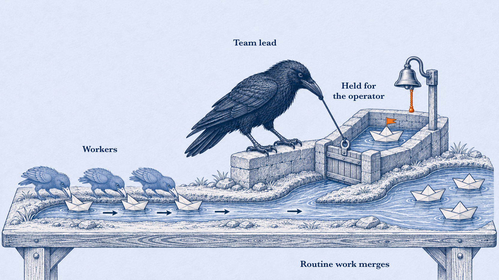

# Concepts

Shared domain vocabulary for this project, including entities, named processes,
and statuses with a project-specific meaning. Prefer an established industry
term or a plain description. Add a project term only when it names a precise
requirement used in more than one place or stored data needed for compatibility.
Do not capitalize ordinary workflow phrases merely to turn them into concepts.
This is a glossary, not a specification or catch-all.

## Personal workflows

### Meaningful Commitment

A reviewed next-day intention that connects current evidence or an explicit user
premise, a user-chosen outcome, and observable proof of completion.

It may be written as natural prose. If the user's exact wording omits one part,
preserve it but do not present it as complete. It records intent without
replacing task or calendar state.

### Source map

A private map from chief-of-staff information roles to user-designated sources.
It records ownership, native access details, and user-approved source
restrictions, not source contents or access results. Workflows select which
roles to read and when, within those restrictions.

### Source Access Audit

A temporary record, shown with one response, of which relevant sources were
checked, what each check found, and how access gaps affected the answer.

It is discarded after the response. It does not prove a claim, authorize a
change, or create stored state.

### Daily CRM Scan

A required wind-down check of configured relationship sources for the active
date window, run before the day's initial reconstruction.

It attributes interactions to known people and proposes only supported contact
updates or useful context. A short gap expands the date window; it does not
start a full CRM catch-up.

### Administrative Sweep

A check of canonical records during a wind-down or weekly review. It proposes
one independently approvable action for every record the evidence shows is
wrong or needs a decision, including overdue, follow-up-due, and at-risk tasks.
It lists nothing healthy and never creates a second task list. Upcoming tasks
normally feed the plan; the sweep proposes an action only when the plan cannot
accommodate them.

The [owning procedure](skills/personal-chief-of-staff/references/administrative-sweep.md)
defines each mode's dates and qualifying findings.
[Wind-down](skills/personal-chief-of-staff/references/wind-down.md) and
[Weekly](skills/personal-chief-of-staff/references/weekly.md) define when it runs.

### Frontier Round

One numbered batch of at most five independent questions, each with a
recommended answer, presented in plain chat and answered in one reply. A
question enters only when its answer could materially change the
recommendation, plan, or interpretation and its prerequisites are settled;
dependent questions wait for the next round. A round with zero questions is
valid.

## Workflow processes

### Delivery Sequence

The five-job path from Research through Plan, Design, Build, and Ship. Each job
transforms a named input into an artifact the next job can use. Design is
conditional for interface work and continues through later delivery rather
than existing only as an isolated stop.

### Repository Learning Loop

The Maintain feedback loop that turns recurring repository problems into tests,
rules, reusable procedures, decision records, or documentation. It improves
future work throughout the Delivery Sequence, not only after Ship.

### Personal Learning Loop

The Learn feedback path that turns experience into linked personal knowledge,
names the gap that remains, and returns a better question to Research. It is
distinct from the Repository Learning Loop because it improves the operator's
understanding rather than the repository's safeguards and procedures.

### Leverage

The order for work to choose from: value to users and confidence, divided by
verification effort and undo cost. Verification effort is how hard a result is
to confirm, and undo cost is what it takes to reverse a change that turns out
wrong. [PRIORITIZATION.md](PRIORITIZATION.md) defines the scales.

## Choosing models

### Base

The measured starting point for model recommendations: benchmark suites from
different operators that report quality and cost for the same model, effort,
and tasks, put on one scale. It covers coding and general work. It gives a
model order and each model's best-value effort.

### Setting

One model at one effort. The recommendations compare settings, so a model is
"better" when its listed setting scores higher, whatever it could reach at
another effort. A model's best score at any effort is its ceiling.

### Order

How settings are listed. A setting at least as good for no more cost goes
first. Otherwise the better-scoring setting goes first only when it costs at
most 40% more for each point of quality it adds.

### Best-Value Effort

The effort setting to stop at for a model: the last one before the next step
up costs too much for what it adds. A step's price is how much more it costs,
in percent, for each added point of quality. Efforts that a cheaper effort of
the same model beats are left out first.

### Frontier

The settings no other setting beats on both quality and cost. A listed
setting off the frontier has a cheaper alternative that scores at least as
well.

### Practitioner View

What people who use the models report, gathered from recent public posts at
each refresh. A report does not change a row by itself. It informs the
maintainer's judgment, and an adjustment that rests on one says so.

### Judgment

The maintainer's own call, made last. It can override the measurements when
the adjustment says so and names what would change it.

### Everyday Model

The model a vendor itself recommends for most day-to-day work. When the
vendor's own sources disagree, it is the model the vendor's coding tool runs
by default to do the work. It starts the Executor row.

### Flagship

The model a vendor recommends for its hardest work. It starts the Team Lead
row.

### Rationed

A model the vendor's plan limits more tightly than its others, by a cap, a
faster draw on the plan's allowance, or billing to credits. A rationed model
never takes another model's slot in the Executor or Team Lead row, even when
it scores higher for less.

### Role Input

A recorded fact that bears on a role the base does not measure: a vendor's
own model guidance, a related benchmark, or a preference ranking. Each has a
source and the date it was read.

### Adjustment

A written departure from the base in a role's recommendation. It
states from what, to what, which role input justifies it, and what would
reverse it.

## Coordinating work

### Team Lead

The session that owns a piece of work and answers for its result. It thinks
through the hard parts, hands the rest to workers, and is accountable for the
quality and output of every worker. In a coordinated batch it is the session
the operator talks to. Orca's guides call it the coordinator, and older
records call it the Coordinator.

### Coordinated Batch

One Team lead, its task workers, and its record, working the issues and epics
the operator handed it. An epic brings the child issues it had when handed
over. The operator adds scope by telling the Team lead, which records the
operator's words, or by approving an issue the Team lead drafted. The
Team lead dispatches nothing outside that scope. The batch ends when its scope is done or
the operator ends it.

### Merge Approval

What the operator approved a Team lead to merge without them: the merge bar
and held changes shown in the setup proposal for one coordinated batch, applied
to the batch's scope, with any held change the operator pre-authorized under a
stated bar and any change the operator made in recorded words to the scope,
merge bar, or held changes. Only the operator's recorded approval creates or
changes it. It covers merging and nothing else.

### Held Changes

The changes that wait for the operator, however clean the pull request, unless
the operator pre-authorized them. Two tests decide. First, a list of sensitive
kinds: by default access and authorization, money, data deletion, privacy,
outbound email, release gates, CI workflows and composite actions, git-hook
and secret-scanner configs, dependency lockfiles, and the project's agent
instructions and merge and review policy. Second, the score line: verification
effort multiplied by undo cost is 3 or more, taking the higher of the issue's
stored scores and what the pull request's diff shows, or any diff the reviewer
cannot read clearly. Repo policy is read from the default branch, so a pull
request cannot loosen the tests it is judged by. A project's own guidance or
the operator's edit to a proposal can change the list of sensitive kinds; only
the operator's own edit moves the score line.

## Issue management

### Canonical Tracker

The one issue system authorized to own a repository's issues and receive changes
to them. A cross-tracker request may reach its canonical record only through one
exact provider-native link; otherwise Managing Issues asks for the canonical
issue or stops. An issue in another tracker is not a second write target.

### Implementation Leaf

One issue whose deliverable and Verification boundary fit one independently
deliverable, reviewable pull request. A stacked PR series is one leaf only when
no PR in the stack delivers independently observable behavior; otherwise each
such PR is its own leaf. A single-leaf change needs no artificial parent. An
issue whose deliverable is research, a decision, or a person's action is not an
implementation leaf and gets no estimate; one whose Verification allows an
outcome that ships a pull request is a leaf and gets one.

### Ready Frontier

The implementation leaves in a requested issue family whose derived readiness
is `ready` and whose current native blockers and declared prerequisites are
satisfied. It is determined from a fresh read of the canonical tracker before a
handoff and listed in [Leverage](#leverage) order, highest first. It is never
stored as a separate record of work status.

## Shipping and verification

### Install Probe

The per-harness smoke check proving that an exact skill revision installs
through the repository's documented path and activates on one trigger query.
A passing probe establishes installability and activation for that harness
only; it is not behavioral evidence. The maintainer runs it after merge,
against the published state. Agents never install a candidate locally to
probe it.

### Installation Parity

The maintainer installs from this repository exactly the way a visitor does.
Nothing in the [published catalog](skills/README.md) may depend on context
that exists only on the maintainer's machine, including absolute paths, private
names, or personal-environment assumptions. The repository text check rejects
local home-directory paths in tracked files; review covers private names and
other personal-environment assumptions. The rule binds from the moment the
repository declares itself public-bound, regardless of its current hosting
visibility.

### Release Snapshot

An immutable semantic-version tag and GitHub Release that identify one validated
state of the published catalog. It is a historical checkpoint with release
notes, not an installation pin: ordinary installs continue to follow `main`, and
a correction receives a new release tag instead of moving an existing one.

### Review Round

The pull requests gathered across repositories for the operator to review in
one sitting: every one in a repository they can merge in, and every one that
asks for their review. Each is fixed at the head commit it was read at. The
operator answers a round with one set of [Verdicts](#verdict).

### Verdict

The operator's decision on one pull request in a [Review Round](#review-round),
at the head commit reviewed: `merge`, `request changes`, `defer`, or
`not applicable`, for a pull request that is not theirs to decide. A merge
Verdict covers the change as it stood at that head. A later change to the pull
request is judged on its own by the [Held Changes](#held-changes) tests,
including a check that a rebase did not quietly revert work on the default
branch: a routine delta merges under the same Verdict, and any other delta
returns to the operator. A merge Verdict clears a hold on that pull request
and never changes [Merge Approval](#merge-approval).

### PR Review Labels

Three GitHub labels that show where a pull request stands in review.
`review:held` marks one waiting for the operator in a
[Review Round](#review-round). `review:auto-merged` marks a routine one merged
under [Merge Approval](#merge-approval). `review:human-merged` replaces
`review:held` once GitHub confirms that a held pull request merged after a
merge [Verdict](#verdict). The labels are for visibility and reporting. A
review reads every open pull request, and every one merged since the
operator's last Verdicts, so a missing or stale label never hides one, and no
label permits a merge.

## Evaluation

Tests never call a model; evals always do.

### Product Eval

An eval of an AI feature of an application. It can evaluate a single reply or
a whole conversation, such as a live voice practice session. The Rookery ships
no AI feature, so it has no Product Evals.

### Skill Eval

An eval of a coding agent doing a task with a skill loaded. Each run is a
multi-step agent run, not a single answer.

### Eval Case

One concrete request, with its context and its success criteria.

### Eval Label

A pass or fail on one output for one check, with the reason and who gave it, a
person or a model.

### Eval Record

A saved run of Eval Cases with their Eval Labels, committed to the repository.

### Baseline

The run a result is compared against: a run with no skill, the previous
version of the skill, or the previous model.

### Unmeasured

An evaluation result that was not collected or cannot be trusted, kept distinct
from both pass and fail. An Unmeasured result never counts toward a pass rate,
and an earlier run is not reclassified later to fill the gap.

## Research synthesis

### STORM Research

A deep, source-backed investigation that establishes what is already known,
assigns independent research perspectives, preserves their disagreements, and
combines the findings for the requested purpose. It asks questions about facts,
assumptions, constraints, mechanisms, system relationships, change over time,
and downstream effects without requiring a separate named question type. It may
inform a decision, but unlike `ce-pov`'s compact, project-grounded verdict it
preserves a multi-perspective research record as the primary result.
