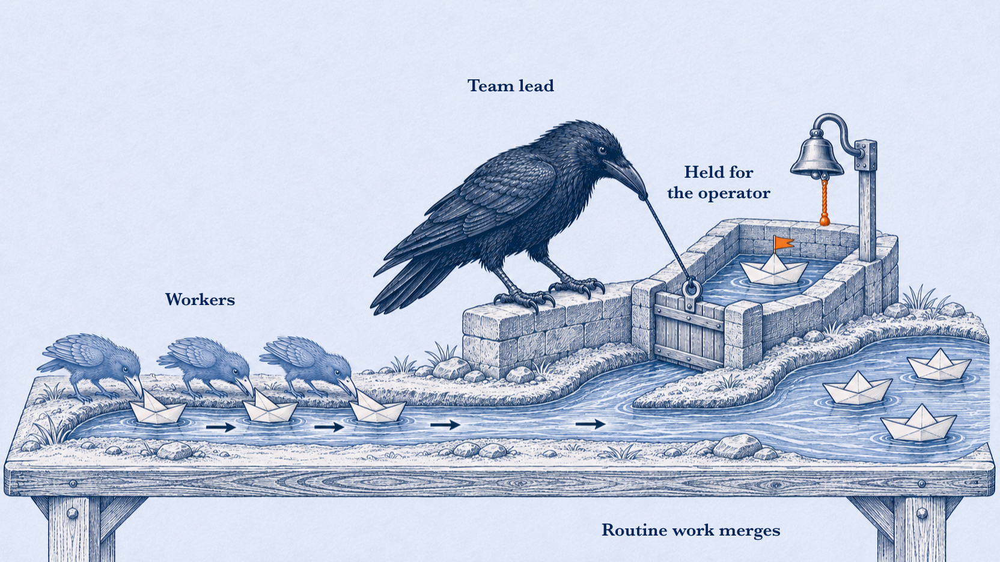

# Glossary

The shared vocabulary of this project: the entities, named processes, and
statuses that mean something specific here. Prefer an established industry
term or a plain description. Add a project term only when it names a precise
requirement used in more than one place, or stored data that has to stay
compatible. Capitalizing an ordinary workflow phrase does not make it a
concept. This is a glossary, not a specification.

## Personal workflows

### Meaningful Commitment

An intention for the next day, reviewed with the user, that ties together
current evidence or a premise the user stated, an outcome the user chose, and
how anyone could see it was done.

It can be written as ordinary prose. If the user's own wording leaves out one
of the three parts, keep their wording but do not present it as complete. It
records an intention; tasks and the calendar still hold the actual plan.

### Source map

A private list that says which of the user's sources fills each information
role the chief-of-staff workflows use.
It records who owns each source, how to reach it, and any limits the user set
on its use. It holds no source contents and no results of reading them.
Each workflow decides which roles to read, and when, within those limits.

### Source Access Audit

A note shown with one response that lists the sources checked, what each
check found, and how any source that could not be read affected the answer.

It is discarded once the response is shown. It is not proof of a claim, it
does not authorize a change, and nothing is stored.

### Daily CRM Scan

A required check, during the evening wind-down, of the user's configured
relationship sources for the dates under review. It runs before the day is
reconstructed.

It matches interactions to people already known and proposes only contact
updates or context the evidence supports. After a short gap, it widens the
dates; it does not turn into a full CRM catch-up.

### Administrative Sweep

A check of the records that hold the user's real state, such as their tasks,
during a wind-down or weekly review. For each record the evidence shows is wrong or needs a
decision, including overdue tasks, follow-ups that are due, and tasks at risk,
it proposes one action the user can approve on its own. It lists nothing that
is healthy and never keeps a second task list. Upcoming tasks normally go into
the plan; the sweep proposes an action for one only when the plan cannot fit
it.

The [owning procedure](skills/personal-chief-of-staff/references/administrative-sweep.md)
defines each mode's dates and what counts as a finding.
[Wind-down](skills/personal-chief-of-staff/references/wind-down.md) and
[Weekly](skills/personal-chief-of-staff/references/weekly.md) define when it
runs.

### Frontier Round

One numbered set of at most five questions put to the user at once, each with
a recommended answer, asked in plain chat and answered in one reply. A
question is included only when its answer could change the recommendation,
plan, or reading of the situation, and when every question it depends on is
already answered; the others wait for the next round. A round with no
questions is valid.

### Knowledge Frontier

The ideas just beyond what a learner's notes already cover: the ones they
could learn next because they build on what they know. A learning coach maps
it when the user asks what they don't yet know about a topic.

## Workflow processes

### Delivery Sequence

The five jobs that take work from idea to release: Research, Plan, Design,
Build, and Ship. Each job turns a named input into something the next job can
use. Design applies only to work with an interface, and it continues through
the later jobs rather than standing as a separate stop.

### Repository Learning Loop

The Maintain loop: it turns problems that keep recurring in the repository
into tests, rules, reusable procedures, decision records, or documentation. It
improves later work at every stage of the Delivery Sequence, not only after
Ship.

### Personal Learning Loop

The Learn loop: it turns the operator's experience into linked personal
knowledge, names the gap that is left, and hands a sharper question back to
Research. It differs from the Repository Learning Loop because it improves
the operator's understanding, not the repository's safeguards and
procedures.

### Leverage

The order in which to take work from a list of choices: the value to users
times our confidence it will deliver, divided by how hard the result is to
confirm times the undo cost: what a wrong change could break and what it would
take to reverse it. [PRIORITIZATION.md](PRIORITIZATION.md) defines the scales.

## Choosing models

These terms describe how [ROUTING.md](ROUTING.md) recommends a model for each
role.

### Base

The measured starting point for model recommendations: benchmark suites from
different publishers that report quality and cost for the same model, effort,
and tasks, combined on one scale. It covers coding and general work, and it
gives an order of models and each model's best-value effort.

### Setting

One model at one effort level. Recommendations compare settings, so one model
is "better" than another when its listed setting scores higher, whatever
either could reach at another effort. A model's best score at any effort is
its ceiling.

### Order

How settings are listed. A setting that is at least as good for no more cost
comes first. Otherwise, a higher-scoring setting comes first only when it
costs at most 20% more for each point of quality it adds.

### Best-Value Effort

The effort level to stop at for one model: the last level before the next step
up costs too much for what it adds. A step's price is how much more it costs,
in percent, for each point of quality it adds. Levels that a cheaper level of
the same model beats are set aside first.

### Pareto Frontier

The settings that score higher than every cheaper setting. A listed
setting that is not on the frontier has a cheaper alternative that scores at
least as well. ROUTING.md calls it "the frontier".

### Practitioner View

What people who use the models report, gathered from recent public posts each
time the recommendations are refreshed. A report does not change a
recommendation on its own. It informs the maintainer's judgment, and an
adjustment that relies on one says so.

### Judgment

The maintainer's own call, made last. It can override the measurements when
the adjustment says so and names what would change it.

### Everyday Model

The model a vendor itself recommends for most day-to-day work. When the
vendor's own sources disagree, it is the model the vendor's coding tool runs
by default. It is the starting point for ROUTING.md's Executor row, the role
that does most of the work.

### Flagship

The model a vendor recommends for its hardest work. It is the starting point
for ROUTING.md's Team Lead row.

### Rationed

A model that a vendor's plan limits more tightly than its others, through a
cap, a faster draw on the plan's allowance, or billing to credits. A rationed
model never takes another model's place in the Executor or Team Lead row, even
when it scores higher for less.

### Role Input

A recorded fact that bears on a role the base does not measure: a vendor's
own guidance about its models, a related benchmark, or a preference ranking.
Each one names its source and the date it was read.

### Adjustment

A written departure from the base in a role's recommendation. It says what
changed from what, which role input justifies it, and what would reverse it.

## Coordinating work

### Team Lead

The agent session that owns a piece of work and answers for its result. It
thinks through the hard parts, hands the rest to worker sessions, and is
accountable for the quality and output of every worker. In a coordinated
batch it is the session the operator talks to. Orca's guides call it the
coordinator, and older records call it the Coordinator.

### Captain

The one persistent session per repository that plans with the operator,
dispatches Executors directly or through Domain Leads, and is the only session
that merges in that repository. It acts only on the operator's recorded words
and on live facts it rereads at every wake, and it never blocks on the
operator. Do not call it the Coordinator.

### Domain Lead

A session a Captain starts to run one group of related work, such as a Design
Lead for UI work that shares a design system. It briefs its own Executors,
never merges, and hands ready and held pull requests up to the Captain. It
exists only while it has active work.

### Coordinated Batch

One Team lead, its task workers, and its record, working the issues and epics
the operator handed it. An epic brings the child issues it had when it was
handed over. The operator adds to the scope by telling the Team lead, which
records the operator's words, or by approving an issue the Team lead drafted.
The Team lead dispatches nothing outside that scope. The batch ends when its
scope is done or the operator ends it.

### Merge Approval

What the operator has approved a Team lead or a Captain to merge without
asking again. For a Team lead, it starts as the merge bar and the held changes
shown in the setup proposal for one coordinated batch, applied to that batch's
scope. For a Captain, it is the approval recorded in its charter for its
repository's approved scope. Either way, it also includes any held change the
operator pre-authorized under a stated bar, and any change the operator made,
in recorded words, to the scope, the merge bar, or the held changes. Only the
operator's recorded approval creates or changes it. It
covers merging and nothing else.

### Held Changes

The changes that wait for the operator, however clean the pull request,
unless the operator pre-authorized them. Two tests decide: a list of sensitive
kinds, and a score line on verification effort and undo cost. The review
contract's [hold tests](skills/reviewing-prs/references/review-contract.md#hold-tests)
state both. A project's own guidance, or the operator's edit, can change the
list of sensitive kinds; only the operator's own edit moves the score line.

## Issue management

### Canonical Tracker

The one issue system allowed to own a repository's issues and to receive
changes to them. A request that starts from an issue in another tracker
reaches the canonical issue only through one exact link that the tracker
itself provides; otherwise Managing Issues asks for the canonical issue or
stops. An issue in another tracker is never a second place to write.

### Implementation Leaf

One issue whose deliverable and Verification fit one pull request that can be
delivered and reviewed on its own. A stacked series of pull requests is one
leaf only when no pull request in the stack delivers behavior anyone could
observe on its own; otherwise each such pull request is its own leaf. A
change that fits one leaf needs no parent issue. An issue whose deliverable
is research, a decision, or a person's action is not an implementation leaf
and gets no estimate; one whose Verification allows an outcome that ships a
pull request is a leaf and gets one.

### Ready Frontier

The implementation leaves in a requested issue family that are ready to work
now: their readiness is `ready`, and their current blockers in the tracker
and their declared prerequisites are all met. It is worked out from a fresh
read of the canonical tracker before work is handed off, and listed in
[Leverage](#leverage) order, highest first. It is never stored as its own
record of work status.

## Shipping and verification

### Install Probe

A quick check, run once per agent tool, that an exact skill revision installs
the way the repository documents and loads on one test request. Passing it
shows the skill installs and loads in that tool, not that it behaves well.
The maintainer runs it after merge, against the published version. Agents
never install an unmerged version locally to probe it.

### Installation Parity

The maintainer installs from this repository exactly the way a visitor does.
Nothing in the [published catalog](skills/README.md) may depend on anything
that exists only on the maintainer's machine, such as absolute paths, private
names, or assumptions about their personal setup. The repository's text check
rejects local home-directory paths in tracked files, and review catches
private names and other personal assumptions. The rule applies from the
moment the repository declares itself headed for public release, whatever its
current visibility.

### Release Snapshot

A semantic-version tag and GitHub Release that mark one validated state of the
published catalog and never move. It is a historical checkpoint with release
notes, not a version to install from: ordinary installs follow `main`, and a
correction gets a new release tag rather than moving an old one.

### Review Round

The pull requests, gathered across repositories, that the operator reviews in
one sitting: every one in a repository they can merge in, and every one that
asks for their review. Each is fixed at the head commit it was read at. The
operator answers a round with one set of [verdicts](#verdict).

### Verdict

The operator's decision on one pull request in a [Review Round](#review-round),
at the head commit reviewed: `merge`, `request changes`, `defer`, or
`not applicable` for a pull request that is not theirs to decide. A merge
verdict covers the change as it stood at that commit. A later change to the
pull request is judged by the review contract's
[after-verdict rule](skills/reviewing-prs/references/review-contract.md#after-a-verdict).
A merge verdict clears a hold on that pull request and never changes
[Merge Approval](#merge-approval).

### PR Review Labels

Three GitHub labels that show where a pull request stands in review.
`review:held` marks one waiting for the operator in a
[Review Round](#review-round). `review:auto-merged` marks a routine one merged
under [Merge Approval](#merge-approval). `review:human-merged` replaces
`review:held` once GitHub confirms that a held pull request merged after a
merge [verdict](#verdict). The labels are for visibility and reporting only.
A review reads every open pull request that is ready for review and every one
merged recently, so a missing or stale label never hides one, and no label
allows a merge.

## Evaluation

Tests never call a model; evals always do.

### Product Eval

An eval of an application's AI feature. It can judge a single reply or a whole
conversation, such as a live voice practice session. The Rookery ships no AI
feature, so it has no Product Evals.

### Skill Eval

An eval of a coding agent doing a task with a skill loaded. Each run is a
multi-step agent run, not a single answer.

### Eval Case

One concrete request, with its context and what counts as success.

### Eval Label

A pass or fail for one output on one check, with the reason and who gave it,
a person or a model.

### Eval Record

A saved run of Eval Cases with their Eval Labels, committed to the
repository.

### Baseline

The run a result is compared against: a run with no skill, with the previous
version of the skill, or with the previous model.

### Unmeasured

An eval result that was not collected or cannot be trusted, kept apart from
both pass and fail. An Unmeasured result never counts toward a pass rate, and
an earlier run is never relabeled later to fill the gap.

## Research synthesis

### STORM Research

A deep, source-backed investigation. It first establishes what is already
known, then assigns independent research perspectives, keeps their
disagreements, and combines their findings for the purpose at hand. Its
questions cover facts, assumptions, constraints, mechanisms, how parts of a
system relate, change over time, and knock-on effects, without needing a
separate named type for each. It can inform a decision, but unlike `ce-pov`,
which gives a short verdict grounded in the project, its main result is a
record of the research from several perspectives.
