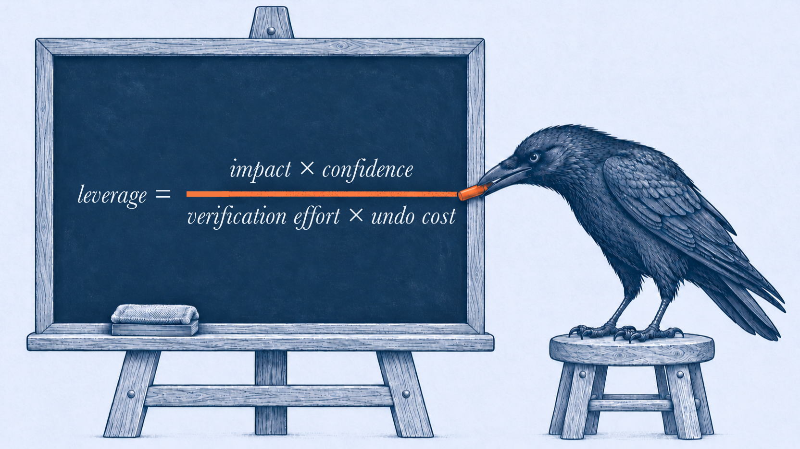

# How I prioritize

I rank work by leverage: how much good a change does, weighed against what it
costs to check and what it would take to undo. When I sort a list of findings,
ideas, or tasks, I use this order.

```text
leverage = (impact × confidence) ÷ (verification effort × undo cost)
```



This is the traditional ICE score (impact, confidence, ease), modified in two
ways for AI development:

- Verification effort replaces ease. Ease asks how much it takes to do the
  work: the time, the people, the cost, and the complexity. With AI that is
  hard to predict, because work that took a person weeks can take an agent
  hours, or sometimes minutes. How hard the result is to verify is easier to
  estimate, and it is more often what holds a change up.
- Undo cost is added. It covers what the change could break and what it takes
  to undo it. The easier a change is to undo, the more freely I can let an
  agent do it on its own. My
  [`repo-captain`](skills/repo-captain/SKILL.md) skill applies this through its
  [review contract](skills/repo-captain/references/review-contract.md): a
  Captain merges routine pull requests without me and holds sensitive changes
  or any pull request where verification effort × undo cost is 3 or more for my
  verdict.

## The four factors

Each factor gets a score from 1 to 3.

| Factor | Question | 1 | 2 | 3 |
|---|---|---|---|---|
| Impact | How much better does this make things for users? | No user task I can name gets better | A named user task gets faster, easier, or more reliable | It decides whether users can do a core task (one most users rely on), or whether they can keep their work safe |
| Confidence | How sure am I that this will deliver the impact I scored? | A hypothesis: a stated reason with nothing behind it yet | A hypothesis with indirect evidence, such as a user report, a similar case, or reading the code | Confirmed by direct evidence for this item: a reproduction, a measurement, a plan that calls for it, or the same fix working here before |
| Verification effort | How hard is it to confirm the result is right? | Checks that existed before the change prove it: tests, types, CI, or a reproduction I already have | It needs new tests, including the change's own, or a manual check with a known right answer | Only judgment can confirm it, such as taste, UX, performance under real load, behavior across systems, or a new user-facing view, flow, or concept |
| Undo cost | If this change is wrong, what does it take to undo it? | Two-way door, contained. One revert puts it back, and it stays within one module | Two-way door, wide. It can be put back, but it reaches shared code, shared settings, or many users, or takes more than one revert | One-way door. It can't be put back: data is lost, a message is sent, money moves, access is exposed, or a stored or published name is added or changed (table, column, stored ID or enum value, event name, public API route or field, CLI flag, configuration key, or published package or skill name) |

Impact already covers the harm of doing nothing. A security hole or a
data-loss bug scores high on impact, because users can't trust the product
with their work. Undo cost covers only the change.

Users are whoever uses what the repository ships. When the repository ships
my own tools, I count as a user. Maintainers count only through what their
work unblocks.

Some work changes nothing users see, such as a refactor, a CI fix, or tests
for code that has none. I score it by what it eventually does for users:

- **Impact** is the impact of the problem it prevents or the feature it
  unblocks. Tests for an untested save feature prevent lost work, so they
  score 3. A refactor that a planned feature needs gets that feature's score.
- **Confidence** is how likely that benefit is. It scores 3 if the feature is
  already planned or the problem has happened before, and 1 if it only might
  happen someday.

If I can't name a benefit for users, impact is 1.

A change includes its own tests. Tests count as separate work only when they
cover code that already exists.

Three examples:

- A bug that loses saved work, with a reproduction I already have and a
  one-line, isolated fix: (3 × 3) ÷ (1 × 1) = **9**.
- A refactor that a planned feature needs, in code many callers use and no
  tests cover. The feature is a clear improvement to something users do
  often, and the refactor needs new tests as part of the work:
  (2 × 3) ÷ (2 × 2) = **1.5**.
- An idea to redesign onboarding. It could change whether new users get
  started at all, but it is a guess, only people can judge the result, and it
  reaches every new user: (3 × 1) ÷ (3 × 2) = **0.5**.

## Why verification effort, not build effort

Effort usually means how much it takes to build something: the time, the
people, the cost, and the complexity. Teams count it in hours, days, story
points, or T-shirt sizes. That worked when people did the building, because a
build estimate covered the whole job. The person writing the code was also
testing it as they went.

AI changed that in two ways. Building still takes real work, but how much is
hard to predict. Work that took a person weeks can take an agent hours, and
sometimes minutes, and I often can't tell which in advance.

Building is also less of the bottleneck than it was. In a
[Harvard study of 655 companies](https://fion.ac/jellyfish.pdf), lines of code
rose 44% after teams adopted agents, but issues resolved rose about 14%. The
authors' summary: "Code review becomes the bottleneck." Anthropic reports the
same about its own engineers. In
[March 2026](https://claude.com/blog/code-review) it said code output per
engineer had grown 200% in a year and that "Code review has become a
bottleneck." By
[October](https://www.anthropic.com/research/employment-at-anthropic), commits
per engineer were five times what they had been six months earlier, and its
report called human attention "a constant bottleneck."

What I can estimate is how hard the result is to verify. Two changes can take
an agent the same time to build. If existing tests prove the first one, it's
done when the build is. If the second needs a person to try it and judge the
result, it takes as long as that judgment takes. Build effort would score the
two the same, and verification effort tells them apart. In
[Anthropic's study of its own staff](https://www.anthropic.com/research/how-ai-is-transforming-work-at-anthropic),
one engineer called Claude "absolutely amazing for everything where validation
effort isn't large in comparison to creation effort."

Judgment is the expensive end of the scale, and a sign-off is a weak check
there. In an
[Anthropic experiment with 50 analysts](https://www.anthropic.com/research/agents-judgment-calls),
each agent's lean on a judgment call was set by a coin flip, and the analysts
"went with their agent's lean 86% of the time."

Verification effort can come down. Give the agent something it can run that
comes back pass or fail, and it can check its own work and keep going
([Anthropic's agent guidance](https://code.claude.com/docs/en/best-practices)
makes the same point). Good tests and CI do that for every later change
([Testing with agents](TESTING.md)). The
[safeguard ladder in Maintain](WORKFLOWS.md#maintain) follows the same idea:
prefer a check that runs automatically, and fall back to a written instruction
only when nothing stronger fits.

I considered two other measures. Human attention is all the time I spend
specifying, steering, and reviewing. It is closest to the real cost, but it is
hard to estimate before the work starts. Decision load is the number of open
questions only I can answer. It catches vague work but misses clear work that
is hard to check. Verification effort is the easiest of the three to score up
front, and checking the result is where much of my attention goes.

## Why undo cost

Verification effort and undo cost answer different questions. Verification
effort is the cost of finding out a change is wrong. Undo cost is the cost of
reversing it after it ships. A CSS tweak with no visual tests is hard to
verify but cheap to undo. A change to access permissions that the tests fully
cover is easy to verify, but exposed access can't be undone.

Undo cost decides how much I can hand off. A two-way door is a change that
can be put back as it was, such as a code change or an issue field whose old
value is known, so an agent can make it on its own. A one-way door is a change
that can't, such as deleting data or sending a message. It waits for my
approval however good the checks are. Without undo cost in
the formula, a change that deletes data could rank near the top just because
it is easy to verify.

One-way doors are also rare, so stopping for them costs little. When
[Anthropic measured about a million agent actions](https://www.anthropic.com/research/measuring-agent-autonomy),
"only 0.8% of actions appear to be irreversible."

## Why not urgency

Leverage doesn't measure deadlines. Some scoring methods add a time factor,
and I leave it out for two reasons. A deadline belongs to the calendar, not to
the work. The four scores stay true until the work changes, but an urgency
score would go stale as the date gets closer. Most of what I rank also has no
deadline, so the factor would score 1 almost everywhere and rarely change the
order.

When an item does have a deadline, the agent gives the date with the item and
scores it the same as it would without one. I move it up myself.

## Priority in the tracker

In GitHub and Linear I keep four priority levels. Leverage sets three of them:
3 or higher is High, 1 up to 3 is Medium, and below 1 is Low. Urgent is the
one level I set by hand, for work that can't wait whatever it scores. An Urgent
issue still gets its four scores, and nothing derived from them changes its
priority.

## Breaking ties

When items tie:

1. An item that another item on the list depends on goes first.
2. A security finding with strong evidence goes above other findings.

## Use the score to decide

The scores are coarse. They put a list in a sensible order so I can see
everything at once and choose. I still read the top of the list, check for
dependencies between items, and move an item when the score misses something.

When an agent ranks work for me, I want the whole list in leverage order, highest
first, with each item's scores. Items it would skip stay on the list with a one-line reason.
Above the list, it names every item that scores 3 on impact, wherever that
item ranks, so a low leverage score can't hide something important.

The next section is the short version I give agents.

## Rank by leverage

When you rank findings, ideas, or tasks for me to choose from, order them by leverage, highest first: (impact × confidence) ÷ (verification effort × undo cost). Score each factor 1 to 3.

- Impact, how much better it makes things for users: 1 is no user task you can name gets better, 2 is a named user task gets faster, easier, or more reliable, 3 decides whether users can do a core task (one most users rely on) or keep their work safe. Work users don't see takes the impact of the problem it prevents or the feature it unblocks.
- Confidence, how sure we are that it will deliver the impact scored: 1 is a hypothesis with nothing behind it yet, 2 is a hypothesis with indirect evidence, such as a user report, a similar case, or reading the code, 3 is confirmed by direct evidence for this item, such as a reproduction, a measurement, a plan that calls for it, or the same fix working here before.
- Verification effort, how hard the result is to confirm: 1 means checks that existed before the change, such as tests, types, CI, or a reproduction on record, prove it, 2 means it needs new tests, including the change's own, or a manual check with a known right answer, 3 means only human judgment can, such as a new user-facing view, flow, or concept.
- Undo cost, what it takes to undo: 1 is one revert within one module, 2 can be undone but reaches shared code, shared settings, or many users, or takes more than one revert, 3 can't be undone, because data is lost, a message is sent, money moves, access is exposed, or a stored or published name is added or changed (table, column, stored ID or enum value, event name, public API route or field, CLI flag, configuration key, or published package or skill name).

Return the whole list with each item's scores. Keep items you would skip, with a one-line reason. Name every item that scores 3 on impact above the list. When an item has a deadline, give the date beside it and score it as if it had none.

This applies to lists of work to choose from. A skill or workflow that states its own ordering or judgment factors keeps them.
