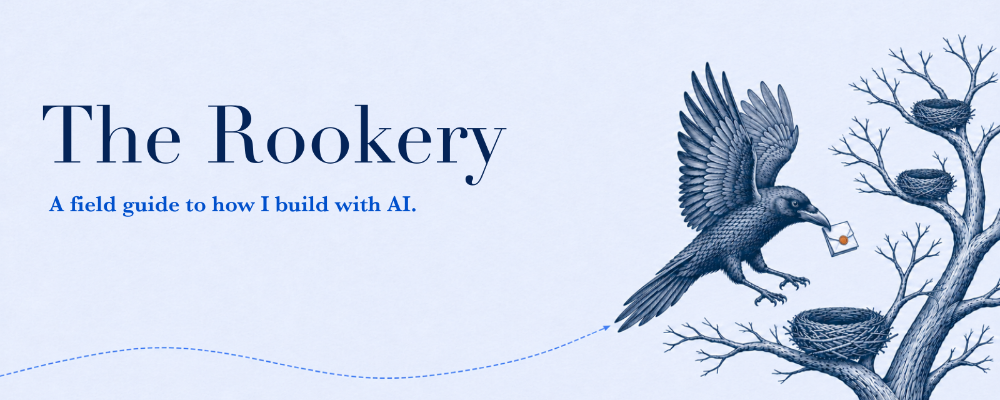

<!-- markdownlint-disable-file MD041 -->



# The Rookery

A field guide to how I build with AI. It connects a practical workflow for research, planning, design, implementation, shipping, maintenance, and learning with the skills and scheduled automations I use to run it.

A rookery is where corvids gather to nest. This one is named for Odin's ravens, Huginn and Muninn. Huginn is thought, Muninn is memory. Each morning they fly out to see the world, and each evening they return with what they've learned.


## Guiding principles

1. **Works across tools.** Skills should not depend on one agent or harness.
2. **Add skills sparingly.** Create one only when existing tools leave a repeated gap.
3. **Improve from use.** Turn recurring failures into tests, rules, or clearer instructions.

## Install

Install skills one at a time or all at once.

```bash
# list available skills
npx skills add jrgilbertson/the-rookery --list

# install one skill
npx skills add jrgilbertson/the-rookery --skill <name>

# or take everything
npx skills add jrgilbertson/the-rookery --all
```

These packages use the [Agent Skills](https://agentskills.io) format supported
by tools including Claude Code, Codex, Cursor, and Gemini CLI. Installation and
runtime behavior remain harness-specific. Add `-g` to install once for your
whole machine instead of per project.
Run `npx skills update` to get the latest changes to your installed skills.

`main` is the rolling catalog and the normal install source. Semantic-version
[Release Snapshots](CONCEPTS.md#release-snapshot) are immutable historical
checkpoints with release notes; they are not install pins.

See [Machine setup](MACHINE-SETUP.md) for the full list of skills, plugins,
and MCP servers I install on each machine.

## The workflows

Everything here fits into five core jobs, Research through Ship, plus two feedback loops: Maintain and Learn. The walkthroughs in [WORKFLOWS.md](WORKFLOWS.md) are how I run that loop. The skills in this catalog plug into it and work in other editors and harnesses too.

- [**Research**](WORKFLOWS.md#research). Gather current evidence, test it against opposing views, and curate enough context to plan.
- [**Plan**](WORKFLOWS.md#plan). Define what to build, the guardrails execution has to honor, and how success will be verified.
- [**Design**](WORKFLOWS.md#design). Set the visual direction and written design system for interface work.
- [**Build**](WORKFLOWS.md#build). Implement the plan in bounded, independently verified slices.
- [**Ship**](WORKFLOWS.md#ship). Review and verify the finished change before merging and documenting it.
- [**Maintain**](WORKFLOWS.md#maintain). Keep repositories healthy by turning recurring problems into durable safeguards.
- [**Learn**](WORKFLOWS.md#learn). Turn experience into linked knowledge and new questions for Research.

[Testing with agents](TESTING.md) explains how I give agents room to work while
permissions, end-to-end tests, and independent checks protect the result. Use it
when setting up your own environment and deciding where safeguards belong.
[How I prioritize](PRIORITIZATION.md) ranks findings, ideas, and tasks by
leverage: impact and confidence weighed against how hard the result is to
verify and what it takes to undo.
[SKILLS.md](SKILLS.md) covers skill validation and evaluation.

## The skills

- [checking-skill-portability](skills/checking-skill-portability/SKILL.md). Check that a skill package works the same in any harness and with any agent that supports the [Agent Skills](https://agentskills.io) specification. Use it before sharing a skill written with Claude Code's or Codex's own `skill-creator`, or when moving a skill between agents.
- [coordinating-work](skills/coordinating-work/SKILL.md). Set up, run, or revive one Team lead in Orca. It works the issues and epics you hand it and is accountable for the quality and output of its task workers. One approved proposal is its merge approval: it merges routine PRs once their issue is proven done, leaves held changes such as billing, access, or work only you can judge open, and keeps one list of what needs you.
- [daily-learning](skills/daily-learning/SKILL.md). Turn daily Obsidian vault activity, reading highlights, local and paired remote AI sessions, and Anki status into a capped learning digest and approval-gated interactive authoring across atomic notes, structure notes, reference-note tags, Anki cards, and personal learning or strategy updates.
- [managing-issues](skills/managing-issues/SKILL.md). Manage GitHub or Linear issues and their native parent and blocker relationships through the repository's canonical tracker. Use it to read, draft, create, or update a single issue or multi-issue graph, and to assess readiness, dependencies, or completion.
- [managing-personal-crm](skills/managing-personal-crm/SKILL.md). Keep relationship context in one note per person while messages and other raw interactions stay in their original apps. Use it to prepare for someone, capture an interaction, reconnect an overdue relationship, or find who could help with current work.
- [personal-chief-of-staff](skills/personal-chief-of-staff/SKILL.md). Turn information from your configured sources into a daily, weekly, or quarterly review. Run it when you need to orient, reflect, and decide what to do next across several parts of your life and work.
- [reviewing-meetings](skills/reviewing-meetings/SKILL.md). Turn completed meetings into draft notes and follow-up actions grounded in the meeting source. Run it after a meeting or during a catch-up when you want to capture outcomes and approve each follow-up before anything is written.
- [reviewing-prs](skills/reviewing-prs/SKILL.md). Review the open pull requests across your repositories, and the ones that ask for your review, in one sitting. It reads each raw diff instead of the description, calls out stored names and missing screenshots, shows the round on one local page that puts the riskiest pull requests first and shows what each one changes for a user, and records your merge, request-changes, defer, or not-applicable Verdict at the exact commit you reviewed. It never merges: the agent working on each pull request acts on your Verdict.
- [storm-research](skills/storm-research/SKILL.md). Research a hard question through independent perspectives and produce a source-backed briefing that preserves disagreements and blind spots. Reach for it when a decision, investment, or long-form deliverable needs evidence from several perspectives.

## The automations

I run recurring reviews in Orca to find improvements in my development work and
support daily personal learning.
The [automation catalog](automations/README.md) contains copyable prompts,
schedules, prerequisites, and setup instructions. Configure these jobs in Orca
separately from installing skills.

- [Sessions audit (local and remote)](automations/sessions-audit.md). Use `ce-retro` to review recent AI sessions on each host for improvements to the coding environment, and check each host for operational drift.
- [Daily learning](automations/daily-learning.md). Run `daily-learning` read-only overnight across vault activity, local and paired remote AI sessions, and Anki status, then author approved updates interactively when you reply.
- [Analytics gap audit](automations/analytics-gap-audit.md). Find shipped user actions without analytics and tracked events that never arrive, and recommend fixes for approval.
- [Design system audit](automations/design-system-audit.md). Review every page against the design contract and recommend fixes for drift and recurring design problems.
- [Improve audit](automations/improve-audit.md). Use shadcn's `improve` to survey the whole codebase and recommend improvements for approval.
- [State-machine correctness audit](automations/state-machine-audit.md). Assess application lifecycles under retries and concurrency, and recommend fixes for approval.
- [Test audit](automations/test-audit.md). Review the tests, find gaps in what they protect, and recommend improvements.
- [Optimize CI](automations/optimize-ci.md). Review continuous integration and recommend improvements.
- [Weekly codebase design](automations/weekly-codebase-design.md). Review codebase design and recommend improvements.
- [Agent entropy audit](automations/agent-entropy-audit.md). Find duplicated truth, dead code, stale guidance, and weakened guardrails, and recommend cleanups, mechanical checks, and standards updates.

## My other projects

- [Networked Thinking](https://networkedthinking.ai). My system for turning what I learn into durable, linked notes, explained through a book and website. Use it when something I learn should become knowledge I can connect and reuse.
- [Networked Thinking Skills](https://github.com/jrgilbertson/networked-thinking-skills). A collection of skills and deterministic helpers for Networked Thinking notes and tasks in Obsidian. Use it when you want an agent to create or audit atomic notes or manage Obsidian tasks.

## Standing on

This system builds on work by people who share theirs. Use them directly.

- [Compound Engineering](https://github.com/EveryInc/compound-engineering-plugin) by Trevin Chow ([@trevin](https://x.com/trevin)) and Kieran Klaassen ([@kieranklaassen](https://x.com/kieranklaassen)). Plans, implements, reviews, and documents the development work.
- [Matt Pocock's skills](https://github.com/mattpocock/skills) by Matt Pocock. The targeted grilling and issue-planning patterns that shaped `managing-issues`, plus [`writing-for-agents`](https://github.com/mattpocock/skills/tree/main/skills/productivity/writing-for-agents) for documents that an agent consumes.
- [humanize](https://github.com/harshaneel/humanize) by Harshaneel Gokhale. Its `ai-check` skill flags AI-sounding writing.
- [Impeccable](https://github.com/pbakaus/impeccable) by Paul Bakaus ([@pbakaus](https://x.com/pbakaus)). Shapes design direction, critiques interfaces, and keeps design systems coherent.
- [last30days](https://github.com/mvanhorn/last30days-skill) by Matt Van Horn ([@mvanhorn](https://x.com/mvanhorn)). Recent-signal research across Reddit, X, YouTube, HN, and the web.
- [Orca](https://github.com/stablyai/orca) by Jinjing Liang ([@JinjingLiang](https://x.com/JinjingLiang)). The agentic IDE I use to run this workflow across several harnesses. The skills also work in VS Code, Claude Cowork, Codex, and other compatible tools.

## Contributing

Fixes and portability PRs are welcome. New skills start as an issue. See [CONTRIBUTING](CONTRIBUTING.md) for how this repo stays healthy.

This is a solo-maintained project with no support SLA. Please report security
issues privately through the process in [SECURITY.md](SECURITY.md), and use the
[Code of Conduct](CODE_OF_CONDUCT.md) for community participation.

## License

[MIT](LICENSE).
