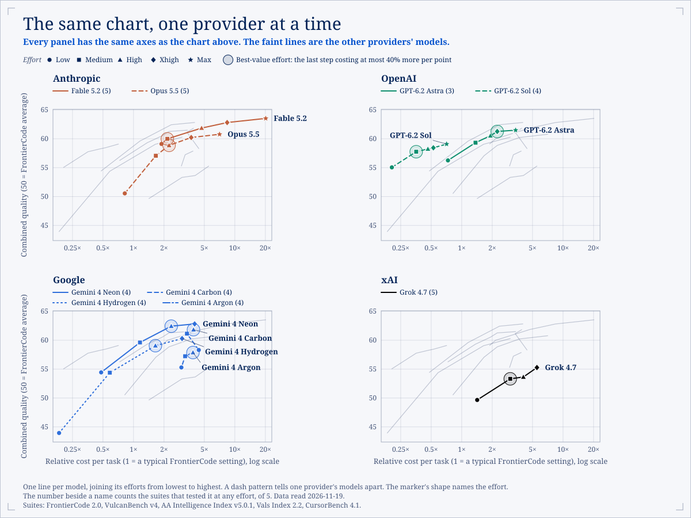

# Match the model to the work

Choose a model and how long it should think based on the work you need done. Use the tools and subscriptions you have. To choose a workflow, see [WORKFLOWS.md](WORKFLOWS.md).

## What each role needs

### Team lead

Own the outcome. Decide what needs doing, in what order, and how we'll know it's finished. Think through the hard parts yourself, hand separable work to Executors, and answer for the quality of what they produce. A session with no workers that plans or works a hard problem uses this row too. For a batch that runs unattended, [`coordinating-work`](skills/coordinating-work/SKILL.md) sets up the team lead and its task workers.

### Executor

Make the changes or find and fix the problem. Use tests and other checks to show that the result works.

### Design/taste

Produce or assess an interface that looks good and is easy to use. People's preferences decide this role, so rankings of what people preferred help choose a model. More thinking time does not automatically produce a better design.

### Writing

Draft or edit prose that people will read, such as documentation, posts, and messages. Readers judge it by preference, as with design.

## Model recommendations

**Last reviewed: 2026-11-24**

![Recommendations reviewed 2026-11-24. Team lead: Gemini 4 Neon (`gemini-4-neon`) at high, then Claude Fable 5.2 (`claude-fable-5-2`) at medium, then GPT-6.2 Sol (`gpt-6.2-sol`) at max. Executor: Claude Opus 5.5 (`claude-opus-5-5`) at high, marked as my judgment, then GPT-6.2 Sol (`gpt-6.2-sol`) at medium, then Gemini 4 Neon (`gemini-4-neon`) at medium. Design/taste: Claude Fable 5.2 (`claude-fable-5-2`) at medium, then GPT-6.2 Astra (`gpt-6.2-astra`) at medium, then Gemini 4 Neon (`gemini-4-neon`) at high. Writing: Claude Fable 5.2 (`claude-fable-5-2`) at medium, then Gemini 4 Neon (`gemini-4-neon`) at high, then GPT-6.2 Astra (`gpt-6.2-astra`) at medium.](docs/assets/routing-table.svg)

Each row names a model from each provider, best first, with its effort setting, so take the first one you can run. The same picks, with model ids for tools and agents, are in [`recommendations.csv`](docs/routing/recommendations.csv), and the figure is drawn from that file.

A model marked \* is my judgment: the method would have put a different model there, and the reasons below say why and what would change my mind. This review has one mark, on the Executor row.

Claude plans that include Fable let it use up to half of the weekly limit, which the other Claude models share, according to Claude's [help center](https://support.claude.com/en/articles/15424964-claude-fable-models-on-your-plan). When that half runs out, use `claude-opus-5-5` at high in Fable's place.

The recommendations cover four providers: Anthropic, OpenAI, Google, and xAI. The suites also test models from other companies, such as DeepSeek, Qwen, and Mistral, and their results stay in `results.csv`, but this page charts and recommends only these four.

Each row shows three providers. Grok 4.7 has no slot. It comes fourth in the Executor and Team lead rows, since GPT-6.2 Sol at medium scores higher than Grok at any effort and costs less. The Arena boards behind Design/taste and Writing now score it, but below each row's three providers: 1639 on WebDev and 1421 on creative writing.

### What each model gains as you raise its effort

![One chart of combined quality against relative cost per task for nine models from four providers, each drawn as a line joining its efforts from lowest to highest. On data read 2026-11-24, Gemini 4 Neon at high scores about 61 at 2.0 times the cost of a typical setting, and Gemini 4 Carbon at high about 61.5 at 3.9 times. Fable 5.2 at high scores about 62 at 4.9 times. GPT-6.2 Astra's best value is now medium, about 59 at 1.1 times. GPT-6.2 Sol reaches about 58 at medium for a third of a typical setting's cost, and about 59 at max for three quarters of it. Gemini 4 Carbon's line doubles back because its low effort costs more than its medium. A soft ring in the line's own colour marks each model's best-value effort.](docs/assets/routing-base.svg)

The chart puts five benchmark suites on one scale, so every model shares the same axes. Colour names the provider, a dash tells one provider's models apart, and each marker's shape names the effort, as the key above the chart shows. The chart covers coding and general work, and it shows the current models from the four providers, whether or not I can run them today.

A soft ring in the line's own colour marks each model's best-value effort, the last step up that costs at most 40% more per point of quality. [The rules](#the-rules) define it.

The middle of the chart is crowded. These panels show one provider at a time on the same axes, with the other providers' models drawn faintly behind.



<details>
<summary>The same settings on each suite's own scale</summary>


</details>

### Why these models

The evidence is in [`docs/routing/`](docs/routing/), and [How I update the table](#how-i-update-the-table) explains the method. The base gives each model its best-value effort and its place in the price order. Here are the charted models at their best-value efforts, in the method's order:

| Model | Best value | Combined quality | Relative cost | Suites | On the frontier |
|---|---|---|---|---|---|
| GPT-6.2 Sol | medium | 57.8 | 0.37 | 3 of 5 | yes |
| Gemini 4 Neon | high | 60.8 | 2.02 | 4 of 5 | yes |
| GPT-6.2 Astra | medium | 58.7 | 1.11 | 4 of 5 | no |
| Fable 5.2 | medium | 60.2 | 2.23 | 4 of 5 | no |
| Gemini 4 Hydrogen | high | 58.8 | 1.56 | 3 of 5 | no |
| Gemini 4 Carbon | high | 61.5 | 3.93 | 4 of 5 | yes |
| Opus 5.5 | high | 59.1 | 2.32 | 5 of 5 | no |
| Gemini 4 Argon | high | 58.0 | 4.62 | 4 of 5 | no |
| Grok 4.7 | medium | 53.5 | 3.03 | 3 of 5 | no |

Sol comes first even though Neon scores 3.0 points more. Neon costs about 450% more, which is 150% for each added point, well past the 40% limit. Relative cost is a multiple of a typical FrontierCode setting's cost, so 2.02 means 2.02 times that. A model off the frontier has some other setting that scores higher for less. Fewer suites means a less certain position.

#### Team lead

This row starts from each vendor's flagship, the model it recommends for its hardest work: Fable 5.2, GPT-6.2 Astra, Gemini 4 Carbon, and Grok 4.7. Astra's best-value effort is now medium, at 58.7 for a relative cost of 1.11. GPT-6.2 Sol at max scores 59.1 at 0.74, higher for less, so Sol at max takes OpenAI's slot. On the suites that tested both, Gemini 4 Neon at high beats Carbon at high, 62.4 to 61.6 on FrontierCode, the AA Intelligence Index, and CursorBench, at about two thirds of the cost, so Neon at high takes Google's slot. The row goes by quality: Neon at 60.8, then Fable at 60.2, then Sol at max at 59.1.

No suite measures leading a team. The closest is AA-Briefcase, which scores long, multi-step knowledge work:

| Model | Medium | High | Xhigh | Max |
|---|---|---|---|---|
| Opus 5.5 | 1615 | 1681 | 1758 | 1797 |
| Fable 5.2 | 1623 | 1676 | 1737 | 1783 |
| Gemini 4 Neon | 1517 | 1631 | 1699 | not tested |
| Gemini 4 Carbon | 1602 | 1611 | not tested | not tested |
| GPT-6.2 Sol | 1494 | 1541 | 1579 | 1612 |
| GPT-6.2 Astra | 1407 | 1570 | 1593 | 1643 |

Its intervals run about 8 to 12 points either way. At the listed efforts, Neon at high (1631), Fable at medium (1623), and Sol at max (1612) sit within each other's intervals, so Briefcase does not change the order. It agrees on Google's slot: Neon at high leads Carbon at high (1611) by 20 points. Artificial Analysis labels its Claude runs "Default Fallback", so another model may have answered some turns.

The row follows the method, with no adjustment. The previous review moved Fable above Astra on Briefcase; Astra has left the row, so that adjustment no longer applies. Practitioners who name an effort run Fable as lead at high or xhigh, not medium, and launch-week testers report Astra stopping early on long, self-directed work. No one reported running Sol at max as a lead.

Revisit when a suite measures plan quality and downstream success for these releases with the same Executor, or when Briefcase separates Fable at medium from Sol at max by more than its interval.

#### Executor

This row starts from each vendor's everyday model, the one it recommends for day-to-day work: Opus 5.5, GPT-6.2 Sol, Gemini 4 Hydrogen, and Grok 4.7. Anthropic, OpenAI, and Google each describe this model as built for that work. On the suites that tested both, Gemini 4 Neon at medium beats Hydrogen at high, 59.5 to 58.9 on FrontierCode, the AA Intelligence Index, and CursorBench, at about 85% of the cost, so Neon at medium takes Google's slot. Fable 5.2 scores higher than Opus for less, but Anthropic rations it, so Opus keeps Anthropic's slot.

Two more suites test only coding and are worth reading beside the base. The AA Coding Agent Index runs each model inside its maker's own tool. Vals Terminal-Bench publishes results by effort in one shared harness.

| Model and tool | Effort | Coding Agent Index | Cost per task | Minutes per task |
|---|---|---|---|---|
| Gemini 4 Neon in Antigravity | xhigh | 58.6 | $6.86 | 31 |
| Fable 5.2 in Claude Code | high | 58.2 | $7.51 | 31 |
| Opus 5.5 in Claude Code | max | 58.2 | $12.61 | 65 |
| GPT-6.2 Astra in Codex | xhigh | 53.1 | $3.20 | 17 |
| Fable 5.2 in Claude Code | medium | 53.0 | $2.89 | 15 |
| GPT-6.2 Sol in Codex | medium | 45.4 | $0.57 | 8 |

| Model | Effort | Terminal-Bench by effort | Cost per test | Minutes per test |
|---|---|---|---|---|
| Fable 5.2 | high | 71.7% | $13.64 | 51 |
| Opus 5.5 | max | 68.7% | $12.60 | 61 |
| Opus 5.5 | high | 67.7% | $4.70 | 32 |
| GPT-6.2 Astra | xhigh | 64.6% | $2.33 | 12 |

What these suites add:

- **Claude models do better on these coding suites than the base suggests.** On the Coding Agent Index, which runs each model in its maker's tool, Fable at high (58.2) and Opus at max (58.2) sit level with Neon at xhigh (58.6), the leader, and above Astra at xhigh (53.1). It tested Opus only at max and Neon only at xhigh. Terminal-Bench, which runs every model in one shared harness, puts Opus at high (67.7%) above Astra at xhigh (64.6%), and did not test Sol or Neon by effort.
- **Sol is the fast, cheap worker.** It takes 8 minutes and $0.57 a task in Codex at medium. On FrontierCode it passes 42.17% of tasks at $1.62 per pass, against 39.85% at $6.08 per pass for Opus at high.
- **VulcanBench, in the base, now tests these settings side by side.** Opus at high scores 91.1 for $3.27 a task, Sol at medium 88.9 for $0.33, and Neon at medium 87.5 for $0.92. It has not tested Hydrogen.

One adjustment:

- **Opus 5.5 moves to first \*.** The method puts Sol first, then Neon, then Opus. Opus is the worker I rely on day to day, and the coding suites lean its way without settling it. VulcanBench puts Opus at high (91.1) above Sol at medium (88.9), while FrontierCode puts it below (36.3 against 38.3). Terminal-Bench puts Opus at high above Astra at xhigh, but it did not test Sol by effort, and the Coding Agent Index tested Opus only at max. So this is my call, not a measured win. This reverses if a suite tests Opus at high beside Sol and Neon at medium and Opus falls behind, or if my own sessions stop bearing it out.

The previous review put Gemini 4 Neon at medium second by judgment, to reverse if a coding suite tested it beside Sol at medium and Sol matched or beat it. VulcanBench now does, with Sol ahead at a third of the cost, so Sol returns to second and Neon follows it.

Revisit when the Coding Agent Index tests Opus 5.5 at high, when Terminal-Bench by effort adds Sol or Neon, or when subscription costs change the trade.

#### Design/taste

People's preferences decide this row, and the base doesn't measure how an interface looks. Four sources score it, weighted equally. Each is standardized across the current models it lists, and a model's score is the mean over the sources that list it, where 50 is the average and 10 points is one standard deviation.

| Model | Arena WebDev | Design Arena | 21st.dev Design System Bench | Frontier Design | Score |
|---|---|---|---|---|---|
| Fable 5.2 | 1822 at xhigh | 1378 | 85.2 | 1710 | 61.1 |
| Opus 5.5 | 1820 at max | 1454 at high | 73.7 | 1684 | 58.6 |
| GPT-6.2 Astra | 1761 at max | 1324 at max | not listed | 1755 | 55.0 |
| Gemini 4 Neon | 1765 at xhigh | 1392 | not listed | 1430 | 53.7 |
| GPT-6.2 Sol | 1755 at max | 1289 | not listed | 1631 | 50.7 |
| Gemini 4 Carbon | 1769 at high | 1318 | 82.9 | 1337 | 50.7 |
| Grok 4.7 | 1639 at xhigh | 1278 | 72.7 | 1236 | 37.6 |

The row takes each provider's best-scoring model: Fable 5.2, then GPT-6.2 Astra, then Gemini 4 Neon. The margins behind first place are small. Astra leads Sol by 4 points and Neon leads Carbon by 3, and Carbon is the only Gemini model all four sources list. Frontier Design puts every Gemini model well below the OpenAI and Anthropic models, which is most of why Astra moves above them.

Design System Bench ran each model at medium, except Carbon at high. Frontier Design's operator, Contra Labs, runs the freelance marketplace its briefs and voters come from, and its data is not public. Its GPT-6.2 and Neon entries rest on about 110 votes each.

Each pick lists the model's best-value effort, as the rules require. WebDev tested Fable at xhigh and Astra at max. A lower effort is untested for design, not worse, but one practitioner found Astra's interfaces weak at high and decent at xhigh, so raise it when a design calls for more.

Revisit when Design System Bench lists the GPT-6.2 models or Neon, or when Frontier Design's GPT-6.2 and Neon entries reach several hundred votes.

#### Writing

Readers judge writing by preference, so this row works like Design/taste. Two sources score it, weighted equally: Arena's creative-writing board, from about 1.5 million human votes, and Lechmazur's benchmark, where models judge short stories. Arena's overall text board is left out: it covers all kinds of prompts, and Arena already counts once through creative writing.

| Model | Arena creative writing | Lechmazur score (rank of 67) | Score |
|---|---|---|---|
| Fable 5.2 | 1525 at max | 3.56 (2) | 59.0 |
| Opus 5.5 | 1518 at high | 3.35 (6) | 57.4 |
| Gemini 4 Neon | 1504 at xhigh | not listed | 54.0 |
| GPT-6.2 Astra | 1471 at max | 4.30 (1) | 53.9 |
| Gemini 4 Carbon | 1518 at high | 1.62 (19) | 52.0 |
| Gemini 4 Argon | 1521 at high | 0.45 (27) | 48.8 |
| GPT-6.2 Sol | 1436 at max | not listed | 35.3 |

The row takes Fable 5.2, then Gemini 4 Neon, then GPT-6.2 Astra. Neon and Astra are 0.1 apart, and Neon's score rests on Arena alone because Lechmazur doesn't list it. Practitioners point the same way for non-fiction: Stephen Smith ranked Fable first and Neon a close second on board and investor documents, and many Hacker News users say Neon writes docs better than Claude.

The sources are weak. Epoch rated Lechmazur "Flawed" in August 2026 because its grading changed without a version, and the rating still stood on 2026-11-24. No public benchmark scores current models on non-fiction such as documentation, email, or reports, so this row rests on creative writing.

Each pick lists the model's best-value effort. Arena tested Fable and Astra at max, and a lower effort is untested for writing, not worse.

Revisit when Lechmazur lists Neon, or when Surge AI's Hemingway-bench, where professional writers judge business and everyday writing, lists current models. Today its newest entries are Fable 5.1 and Opus 5.

## Choose effort and tools

Start with the effort setting in the table and change it when the task calls for it. API costs don't tell you how much of a subscription allowance a task will use, and time per task is often the better guide. I prefer each provider's official tools, signed in through my subscription.

## How I update the table

The method runs in four steps, from what is measured to what is judged. A refresh covers every row unless I name specific roles, and it considers every current model from the four providers.

1. **The base.** Five suites from five operators measure quality and cost at several effort settings, across coding and general work. A script puts them on one scale, finds each model's best-value effort, and lists the models in order.
2. **Role inputs.** Some roles need more than the base: a vendor's own model guidance, a related benchmark, or a preference ranking. I record each with its source and the date I read it.
3. **The practitioner view.** I scan the last 30 days of public posts for what people who use these models report. A report doesn't change a row by itself. It informs my judgment, and an adjustment that rests on one says so.
4. **My judgment.** I make the final call. Suites can be gamed or badly built, and my own use is evidence. My judgment can override the measurements. When it does, the cell carries an asterisk (\*), and the reasons say what would change my mind.

Each change to a row is an **adjustment**: one line that says from what, to what, which input or judgment justifies it, and what would reverse it. A row with no adjustment follows the method.

### The rules

- **Compare settings.** A setting is one model at one effort. A model is better when its listed setting scores higher, whatever it could reach at another effort.
- **A point of quality is worth up to 40% more cost.** This one figure sets both the best-value effort and the price order.
- **The best-value effort is the last step worth its extra cost.** First drop any effort that a cheaper effort of the same model beats. Then climb from the cheapest and stop before the first step that costs more than 40% extra for each added point. Each model is listed at its best-value effort unless a rule below names another.
- **The Executor row follows the price order.** A setting at least as good for no more cost goes first. Otherwise the better-scoring setting goes first only when it costs at most 40% more for each point it adds. Past that, the cheaper one goes first. If every remaining setting is beaten by another, the best-scoring one goes next. The base table uses the same order.
- **The Team lead row goes by quality.** The higher combined score goes first, and the cheaper setting breaks a tie. A lead's decisions carry the outcome, so cost only sets each model's effort and decides whether a sibling takes a slot.
- **The Executor row starts from each vendor's everyday model, and the Team lead row from its flagship.** Vendors name these in their own guidance. When a vendor's sources disagree, the everyday model is the one its own coding tool runs by default to do the work.
- **A better sibling takes the slot.** If another current model from the same vendor scores higher for less at any effort, compared on the base suites that tested both settings, its cheapest such setting replaces the vendor's pick. Comparing only shared suites keeps a model from losing ground for having been tested more widely. A rationed model never replaces one. A vendor rations a model when its plans cap the model's use, count it faster against the allowance, or bill it to credits.
- **Preference rows weigh their sources equally.** Design/taste and Writing each have their own sources, since cost doesn't measure taste, and each operator counts once. Each source is standardized across the current models it lists, taking a model's best score at any effort, and a model's score is the mean over the sources that list it. Each provider's best-scoring model takes its slot, best first, at its best-value effort.
- **Three providers per row, one model each.** A row takes the first three providers in its order.
- **The frontier shows the best buys.** A setting is on the frontier when no other setting scores higher for less. A listed model whose best-value effort falls off the frontier has a cheaper alternative; the base table shows which ones are.

### Where the evidence comes from

| Source | Operator | Feeds | Kind of evidence | What it is and how it's used |
|---|---|---|---|---|
| [FrontierCode](https://cognition.com/frontiercode) | Cognition | The base | Measured | Coding tasks run in each model's own tool, scored on merge quality with a pass rate and cost. The base's anchor: the other base suites are scaled to it. |
| [VulcanBench](https://vulcanbench.com/leaderboard.html) | VulcanBench | The base | Measured | 23 coding tasks scored on tests passed and code quality, which models judge, with cost and time. One of the five base suites. |
| [CursorBench](https://cursor.com/cursorbench) | Cursor | The base | Measured | Ambiguous multi-file coding tasks, with a score and cost per task. One of the five base suites; it tests no current OpenAI model. |
| [AA Intelligence Index](https://artificialanalysis.ai/leaderboards/models) | Artificial Analysis | The base | Measured | A composite of nine evaluations, mostly general knowledge work, with cost and time per task. One of the five base suites. |
| [Vals Index](https://www.vals.ai/benchmarks/vals_index) | Vals AI | The base | Measured | A composite of eight evaluations, including legal, tax, and finance work, with cost per test. One of the five base suites, read from its per-effort results. |
| Each vendor's model guidance | Anthropic, OpenAI, Google, xAI | Executor and Team lead starting models | Vendor guidance | Which model each vendor recommends for everyday work and for its hardest work, and which it rations. Sets the model each of those rows starts from. |
| [AA Coding Agent Index](https://artificialanalysis.ai/agents/coding) | Artificial Analysis | Executor check | Measured | Each model in its maker's coding tool, scored on three coding suites with cost and time. Read beside the base when judging the Executor row. |
| [Vals Terminal-Bench](https://www.vals.ai/benchmarks/terminal-bench-4) | Vals AI | Executor check | Measured | Terminal tasks with every model in one shared harness, with a separate by-effort chart. Read beside the base when judging the Executor row. |
| [AA-Briefcase](https://artificialanalysis.ai/evaluations/aa-briefcase) | Artificial Analysis | Team lead check | Proxy | Elo on long, multi-step knowledge-work tasks, the closest published match to leading work. Read beside the base when judging the Team lead row. |
| [Arena WebDev](https://arena.ai/leaderboard/code/webdev) | Arena | Design/taste | Preference | People vote between finished web apps. One of four equal sources for Design/taste. |
| [Design Arena](https://www.designarena.ai/leaderboard) | Design Arena | Design/taste | Preference | People vote between generated interfaces, read from its overall agentic board. One of four equal sources for Design/taste. |
| [21st.dev Design System Bench](https://21st.dev/benchmarks/leaderboard) | 21st.dev | Design/taste | Measured | Agents build interfaces in a real repository, scored on how well they use its design system. One of four equal sources for Design/taste. |
| [Frontier Design](https://contralabs.com/frontierdesign/leaderboard) | Contra Labs and BenchFlow | Design/taste | Preference | Professional designers vote blind between websites built from real client briefs. One of four equal sources for Design/taste. |
| [Arena Creative Writing](https://arena.ai/leaderboard/text/creative-writing) | Arena | Writing | Preference | People vote between pieces of creative writing. One of two equal sources for Writing. |
| [Lechmazur Writing](https://github.com/lechmazur/writing) | Lechmazur | Writing | Proxy | Short stories scored by a panel of models; Epoch rated it "Flawed". One of two equal sources for Writing. |
| Public posts from the last 30 days | Many | Any row | Report | What practitioners report from their own use, often second-hand. Informs judgment but never changes a row by itself. |
| My own use | Me | Any row | Judgment | What I have seen these models do. The basis for any pick marked \*. |

Measured means the suite reports quality and cost for the same model, effort, and tasks. Vendor guidance is the vendor's own recommendation, which I take as a statement of what it tuned each model for. Proxy means it measures related work. Preference means people chose between results. Report and Judgment are the last two steps of the method.

A suite joins the base only when it publishes quality and cost at more than one effort per model, a different operator runs it, and it doesn't rerun a suite already there. Each operator counts once, so a second suite from the same operator becomes a role input. Cognition and Cursor sell coding products, and the other three operators are independent evaluators.

Every score and cost from these sources is a row in [`results.csv`](docs/routing/results.csv), so you can check the figures on this page against one table. Counts such as comparisons, ranks, and fallback attempts, and everything a source says in words, are in [`role-inputs.csv`](docs/routing/role-inputs.csv).

[Epoch's benchmark reviews](https://epoch.ai/data/benchmark-reviews-documentation/included-benchmarks) flag known problems with a suite. Check that a finding applies to the version tested before acting on it.

### How I compare

The script reports three figures wherever a suite publishes the inputs.

**Cost per pass = average cost per attempt ÷ pass rate.** At $0.60 per attempt and a 60% pass rate, the calculation is $0.60 ÷ 0.60 = **$1.00 per pass**. Only FrontierCode and VulcanBench publish a pass rate. An index, a preference score, or a partial-credit percentage isn't one.

**Cost per additional quality point = increase in task cost ÷ increase in quality score.** Moving from 48 points at $0.21 to 50 points at $0.32 costs $0.11 ÷ 2 = **$0.055 per additional point**. The 40% rule states the same idea as a percentage: that step raises cost by 52% for two points, which is 26% per point. The example uses raw points for simplicity; the rule itself compares combined points.

**Time per task** is each suite's own figure in minutes, where it publishes one.

To combine the base suites, the script stretches each percent score with a logit and scales each suite against FrontierCode on the settings the two share. A setting's combined score averages the suites that tested it, where 50 is the FrontierCode average and 10 points is one standard deviation. Combined cost is a geometric mean of the suites' costs, each adjusted to FrontierCode's level. The page shows it as relative cost: a multiple of a typical FrontierCode setting's cost, the geometric mean of all its settings. A relative cost of 2 means twice that. It compares settings with each other and is not a bill. When a suite tested a model at only some efforts, it moves that model's whole curve up or down without bending it.

These rules prevent the easiest mistakes:

- **Judge each release on its own results.** A predecessor's score doesn't establish a new release's score or its best effort. A missing result means untested, not poor.
- **Use third-party suites for measurement.** A provider's launch claims don't count as measurements. A provider's guidance on which model to use for which work is a role input.
- **Don't rule a provider out before looking.** Whether I can run a model doesn't remove it from the chart or the rows.
- **Read the page's data before calling a figure missing.** Several suites keep efforts, per-effort results, and errors in the page's embedded data, which the visible text leaves out.
- **Compare settings, not models.** A ranking that tested two models at different efforts compares those two settings, not the models. Say which efforts were tested before saying one leads, and don't read a ranking that names an effort for one model and not the other as comparing them.
- **Note when another model could have answered.** Some runs fall back to another model, and those replies count in the score.
- **Don't read API cost as subscription cost.** Benchmark dollars don't show how much of a plan's allowance a task uses.
- **Choose even when evidence is thin.** Name the gap and what would change the choice.

### Running a refresh

Everything the script needs is in [`docs/routing/`](docs/routing/). `results.csv` holds every read of every suite. `role-inputs.csv` holds what each role input says beyond its figures. `chart.json` names the base suites, the anchor, the sources each preference row weighs, the models the charts draw, and any model a suite names differently. It also records each vendor's everyday model, flagship, and rationed models. The script reads local files only.

`results.csv` is append-only. An import adds a read and leaves earlier reads alone, and the report and charts use each suite's latest read. Importing a suite twice on one date replaces that day's read.

1. **Import the base.** Download FrontierCode's `data.json` and VulcanBench's leaderboard CSV and import each. For the other three, copy the results from the page's data into a plain table of model, effort, score, pass rate, cost, and minutes, and import that.
2. **Import the role inputs** the same way, each as a suite outside the base. Update what `role-inputs.csv` says about each one, with the date read.

   Most sources can be fetched as plain pages or files. The two Arena boards (WebDev and creative writing) cannot: arena.ai refuses automated requests, so read them in a real browser, such as Orca's built-in browser, and say so in `role-inputs.csv`. A summarising reader is not a substitute. On the 2026-11-19 read one gave the wrong page date and dropped the efforts the text board names.
3. **Re-read each vendor's model guidance.** Update `chart.json` with each vendor's everyday model, flagship, and rationed models, and record the sources in `role-inputs.csv`. The script looks for a better sibling only among the models `chart.json` lists, so list any current model that could beat a vendor's everyday model or flagship.
4. **Check names.** If a suite names a model differently, add an alias to `chart.json`. Confirm from the sources that two names are one model before merging them.
5. **Run `changes`** to see what moved since the previous read.
6. **Run the report.** Its `candidates` section lists the charted models at their best-value efforts in order. Its `rows` section builds the Executor and Team lead rows, and its `preference` section scores the Design/taste and Writing rows.
7. **Regenerate the charts** and look at each one. Run it again after the rows are final so the recommendations figure matches `recommendations.csv`.
8. **Write the rows** in `recommendations.csv`. Take the Executor and Team lead rows from the report's `rows` section, and Design/taste and Writing from its `preference` section. Apply any adjustment a role input supports, and write each one as a line. The routing checks fail when a pick names a different model or effort from the report, unless its `judgment` column says `yes`.
9. **Scan the last 30 days** for what practitioners report about the settings in the rows. Record what bears on a row in `role-inputs.csv` as a report.
10. **Apply judgment.** Change any pick I disagree with, set its `judgment` column to `yes`, and write the adjustment with what would change my mind.
11. **Update the page:** the recommendations figure's alt text, which must name every pick, the base table, each role's evidence tables, the chart alt text, the revisit conditions, and the review date.

```bash
python3 scripts/routing/evidence.py import --format frontiercode --file data.json --version 2.0 --date 2026-11-19 --url https://cognition.com/data/frontier-code-2.0/data.json
python3 scripts/routing/evidence.py import --format vulcanbench --file swe-v4-board.csv --version v4 --date 2026-11-19 --url https://vulcanbench.com/assets/data/swe-v4-board.csv
python3 scripts/routing/evidence.py import --format table --suite "Vals Index" --file vals.csv --version 2.2 --date 2026-11-19 --url https://www.vals.ai/benchmarks/vals_index
python3 scripts/routing/evidence.py changes
python3 scripts/routing/evidence.py report
python3 scripts/routing/evidence.py charts
```

The repository checks fail when a committed chart no longer matches the data. Nothing yet checks the figures typed into this page, so step 11 is manual.
