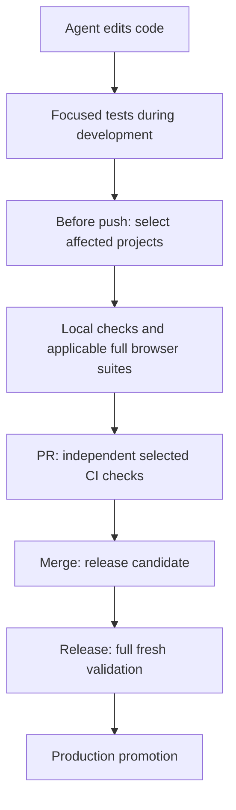

# Testing with agents

Fast feedback lets an agent fix a failure while the change is still in context.
Use that advantage locally, keep merge requirements independently enforced in
CI, and put broader validation before the point where a change reaches users.
Each repository owns the commands and the division of work between those
stages.

## How this works in practice

The coordinator decides what needs checking and in what order. Test runners such
as Vitest, pytest, and Playwright execute the checks. For a monorepo with
several programming languages and separate releases, the flow can look like
this:

A passing PR means all required checks selected for that change passed. It does
not mean every test in the monorepo ran. Full release validation checks the
broader candidate before any change to production. This division of checks
assumes merging and deploying are separate steps. Projects that deploy on merge
must enforce their release requirements at the merge gate.

Consider a repository with a web application, a realtime service, and shared
database contracts:

- A web change selects the web project's required suites.
- A realtime change also selects web when web declares that dependency.
- Ordinary documentation needs only documentation checks when no software
  consumes it at runtime. A document consumed at runtime is an input to that
  software.
- Check more when ownership is unknown or dependency metadata changes. If
  discovery fails, stop verification rather than silently selecting no checks.

Selection starts with whole affected-project suites. Runners discover new tests
by convention, so adding a test does not require a second test list. New
projects still need configured checks. Declare service or database dependencies
when the tooling cannot discover them. Running pytest through Nx does not itself
let Nx discover dependencies from Python imports.

Selection asks whether a project needs checking. Caching then asks whether a
matching computation has already succeeded. An eligible task may reuse that
result; a changed input invalidates it. Browser and stateful checks stay fresh,
as does full release validation. A reported cache hit is prior evidence, not a
new execution.

Give agents three commands they can find: show which checks are selected without
starting services, run those checks, and run all checks without reusing earlier
results. The project chooses their command names. If a normal push already runs
the selected gate, agents need not run that same gate immediately before
pushing. They can use focused runner checks while editing, then let the push
enforce the complete selected gate. The sections below explain the ownership and
failure rules.

## Polyglot monorepos

A monorepo can give a team shared company context: code in several languages,
schemas, prompts, documentation, and working files can move through version
control and review together. A change that crosses these boundaries can be
reviewed and committed as one change. That is useful when several agents work
on the same product.

This fits teams that need to review changes across those boundaries together.
Other organizations may need separate repositories. Shared version control still
needs explicit ownership, appropriate access controls, and ways to find context.
A dependency graph can follow declared packages and supported imports; it does
not understand every HTTP interaction, database contract, or document's meaning.
Include Markdown consumed at runtime and executable documentation among the
inputs to verification. Ordinary team prose need not trigger application tests
once you have established that runtime software does not depend on it.

These principles also fit a small single-language repository. Use the existing
runner directly when a project graph would add little value.

## One project-owned entry point

Give people and agents the same commands for selected verification, full
verification, and inspecting what will run. Keep selection and task ordering
with one coordinator. Nx is one option for a polyglot monorepo; Vitest, pytest,
Playwright, and other runners still execute the tests.

Let package manifests, imports, runner conventions, and executable task
configuration supply dependency and test discovery. Adding a matching test
should not require updating a second file-to-test list. Declare the service and
runtime dependencies needed to select test suites. Run broader checks when
ownership is unknown, a dependency is missing or deleted, or runtime
dependencies are unclear. If the graph cannot be read, a comparison revision is
unavailable, or discovery fails, report the failure. Never report success
because no checks were selected.

Start with full suites for affected projects and their dependents. Use a
runner's narrower selection while editing when useful, while keeping the
required project checks clear. A graph gives conservative impact information; it
does not prove that an apparently unrelated change is harmless.

Put deterministic enforcement in repository commands, Git hooks, and CI so
Grok, Claude, Codex, and other harnesses follow the same rules. The
repository's commands work without AI lifecycle hooks. Git hooks can be
bypassed, so required merge guarantees also need independent CI enforcement.

## Local, merge, and release responsibilities

| Stage | Responsibility |
| --- | --- |
| Editing | Run focused checks immediately, then the affected projects’ required suites and checks locally before handoff. |
| Commit | Keep checkpoints cheap enough to use regularly. |
| Merge | Independently enforce the repository's selected requirements in CI. A report of local success does not replace those CI checks. |
| Release | Run full, fresh validation of the exact candidate before any change to production. |

For a web product, one allocation is full browser coverage locally and at
release, with selected unit, contract, integration, and security checks in PR
CI. This keeps immediate feedback substantial and merge gates lighter without
letting local results substitute for those gates. The project chooses this
division of checks and explicitly accepts that checks deferred until release may
find problems later.

A team that releases periodically can accept finding some problems during
broader release checks. A repository that deploys every merge needs the checks
that protect users before that deployment. Choose the boundary from the actual
delivery model; weekly releases and scheduled full runs are not universal
requirements.

Resolve selection before expensive task-specific setup. Reuse an install,
generated build, or temporary service lifetime where compatible checks can share
it safely. Give one owner responsibility for setting up, using, and shutting
down that shared environment. A reusable workflow or composite action shares
code, but each job may still pay the setup cost. Keep separate environments
where database state, credentials, or isolation require them.

## Cache successful computations carefully

Cache tasks that produce the same result from the same inputs only after
verifying which inputs they use and which outputs they produce. Include relevant
source, tests, dependency and tool versions, configuration, environment values,
and runtime-read assets. Verify that changed inputs invalidate the result and
that required generated outputs are restored.

Start with isolated local caches. Shared or remote caching is a separate choice
with its own trust and maintenance costs. Stateful checks against changing
external services, database integration, migration replay, and live browser
behavior execute freshly. A cache hit is evidence of an earlier successful
computation, not proof of a fresh run.

Distinguish fresh success, cached success, intentional exclusion, failure,
cancellation, and required work that did not run. Provide a direct cache-bypass
command for diagnosis. An observed unresolved failure stays blocking even when
an older successful cache entry exists. Run full release validation freshly.
Dependency download caches may remain, but they do not replace proof that a
clean installation works.

## Handle failures without losing ownership

Record the failing command, revision, and relevant environment. Keep diagnosis
focused by running the failing check on the exact unchanged base revision under
comparable conditions. If it fails there too, you have identified a possible
repair. That does not prove the new change is harmless.

Check whether a repair already has an owner. Propose the repair scope and owner,
and obtain separate approval before expanding the work. Independent work can
continue, but merge waits for repair and passing required checks on the updated
branch. The project's policy determines when to retry or quarantine a failing
test. An agent cannot use either to make a failing result appear successful.

## Adopt through a verified cutover

Compare the old and new paths during implementation on the same controlled
revisions. Exercise new tests, new imports, deletions, shared inputs, cache
invalidation, and injected failures. Record intentionally excluded work
separately from missing guarantees.

Measure local feedback time with and without reusable setup or caches, CI
elapsed time and runner-minutes, setup cost, and unnecessary investigations.
Report ordinary application changes separately from cheap documentation changes.
Keep this comparison within implementation. Once the new path is correct and
delivers the intended improvement, switch the entry points and remove the old
selection and coordination code. Acceptance is based on evidence, not a trial
period or recurring execution of both systems. An ordinary version-control
revert provides rollback without a permanent second operating mode.

## Project policy outline

Use this outline in the document that already owns the project's testing policy.
Record links and decisions rather than copying a list of tasks.

- **Commands:** point to the canonical command and its selected, full, inspect,
  and cache-bypass usage.
- **Executable owners:** point to the coordinator and runner configuration that
  discover projects, dependencies, tests, and cache inputs.
- **Delivery boundary:** name what local work, merge, and release must establish,
  including any deliberately deferred coverage.
- **Resources:** point to the owner of temporary services, worktree isolation,
  and concurrency limits.
- **Failures:** point to the repair owner and the policy for known failures and
  revalidation.

For a TypeScript/Python monorepo, these pointers may lead to one graph and
several native runners. For a small Python library, they may lead to its
existing test command and CI configuration. Neither example needs a second
dependency list in this document.

## Skill validation in this repository

[`SKILLS.md`](SKILLS.md) owns the current skill-validation policy;
[`tests/README.md`](tests/README.md) documents the deterministic repository
checks. Package validation, helper fixtures, repository integrity, and
installation checks each verify their own requirements. They do not establish a
skill's behavioral quality.

Use [`creating-portable-skills`](skills/creating-portable-skills/SKILL.md) for
portable package authoring, auditing, structural validation, and installation.
For behavioral evaluation, start with the evals plugin's `evals-start` skill and
follow the workflow it selects. The first skill being evaluated through this
workflow is `creating-portable-skills`, with Claude, Codex, and Grok as the main
hosts. The other skill packages await revalidation after the eval reset.

An evaluation requires an explicit scope and authorization for model runs.
Neither retired suites nor passing deterministic checks prove that a skill
behaves correctly. Keep raw runs and temporary reports outside the repository,
and report only the behavior actually inspected.
