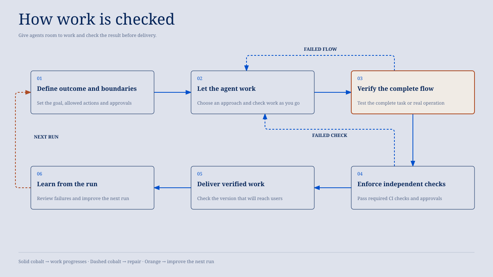

# Testing with agents

I give agents as much freedom as possible to figure out how to do the work. I
put checks and governance around that freedom, then turn recurring failures
into durable safeguards instead of accumulating instructions.

I want the agent to understand the goal and have enough context to choose a
good approach. I also want limits on what it can change and evidence that its
work does what we intended. Instructions help it make decisions, but
permissions and checks carry the parts that should not depend on it
remembering a rule.

This is how I set up a repository for agent work. The same approach can help
you set up your own, whether you are working on a small project or several
connected applications. Start with the tools and checks you already have. Add
something when a problem you have observed, or a limit you need to enforce,
gives it a job.

## How work moves



These six steps describe what needs to happen as the work progresses. They can
use the same tools, and they do not require the agent to stop and ask at every
step. Focused checks run while it works, permissions apply throughout, and a
recurring failure can lead to an improvement before the run is finished.

### Define the outcome and boundaries

Before the agent starts, I describe the result I want, what it may change, and
which actions need approval. I give it the project context and a way to check
its work. That lets it make decisions without having to guess what a good
result looks like. Where the environment can restrict access, I use
permissions and sandboxing to enforce those limits.

Within those limits, the agent can choose how to solve the problem and take
ordinary reversible steps without asking me about each one. Actions outside
its authority still need the required approval. I want the controls to protect
the work while leaving the agent room to exercise judgment.

### Let the agent work

Fast feedback lets the agent correct a failure while the relevant context is
still available. Use focused tests during development, then run the required
checks for the affected work before handoff. For a bug, first reproduce the
failure, then verify the fix through the same path.

Give people and agents the same repository-owned commands. Native test
runners, Git hooks, and CI should work across harnesses without depending on
an AI lifecycle hook. Keep checkpoints cheap enough that agents use them
regularly.

### Verify the complete flow

Individual components can pass their tests while the complete operation still
fails. I want to exercise the path someone will actually use, including the
connections between its parts. For an application, that may be a browser test
of a user completing a task. For setup scripts, it may be an actual
installation in a disposable environment. For documentation, it may be checks
of the links and content. End-to-end testing means following the real
operation far enough to establish the result; it does not always mean using a
browser.

A hook-installation investigation made this concrete. Installing hooks from a
second worktree rewrote the first worktree's launchers. Existing tests mocked
the installer, so they could not catch the interaction. A disposable test with
the real installer reproduced it; a prototype with checkout-owned launchers
preserved both checkouts' checks. The test showed why the checkouts needed
separate launchers. An instruction to coordinate installation would have left
the shared-state problem in place.

I also keep the amount of testing proportionate to the change. The
installation problem justified a test using the real installer because a mock
had missed the failure. A small prose edit would not justify a new
model-evaluation harness. The check should establish the result and protect
the relevant limits without creating more work than the change needs.

### Enforce independent checks

Local feedback helps the agent correct its work. Required CI checks establish
whether the change meets the project's merge requirements independently of the
agent's report. Git hooks can be bypassed, so the checks required before merge
also need to run in CI.

Make failures visible. Record the failing command, revision, and relevant
environment. An unresolved failure in a required check blocks handoff or
delivery. Repeated retries do not make a failing result successful. Give
repair work an owner, and obtain approval before expanding the task's scope.
Required human approvals remain separate from a passing test result.

### Deliver the verified work

The checks need to cover the version that will reach users. If the product has
separate releases, run all required release checks freshly before changing
production. If merging deploys the product, enforce those requirements before
merge. A PR that passes the checks selected for its change does not prove that
every flow in the product has been tested.

Each project decides which checks run locally, before merge, and before a
release. Record any checks deliberately left until later so people know what a
passing result establishes. Run browser tests and checks against changing
service or database state freshly. Reusing dependency downloads can save setup
time without replacing those executions.

### Learn from the run

I look back at recurring corrections, failed checks, and unnecessary
coordination to see what should change before the next run.
[`reviewing-ai-sessions`](skills/reviewing-ai-sessions/SKILL.md) turns session
evidence into proposals to retain, delete, update, or create guidance and
safeguards. It identifies completed remedies separately and leaves changes for
approval through the workflow that owns them.

Sometimes the useful change is to remove a rule or a redundant check.
Sometimes a check that appears repetitive protects a different requirement and
should stay. The session evidence helps distinguish those cases. I put the
lesson in the strongest suitable place so the next run benefits from it.

## Where safeguards belong


The [Maintain durability ladder](WORKFLOWS.md#maintain) describes the homes
for repository learning. For agent testing and governance, I start with the
strongest suitable way to enforce the behavior:

**Permissions/sandbox → hooks/CI/tests → path-scoped rule → skill → prose instruction**

| Home | What it does | Its limit |
| --- | --- | --- |
| Permissions and sandboxing | Restrict available actions and access. | They do not establish that permitted work is correct. |
| Hooks, CI, and tests | Check supported actions, artifacts, and delivery requirements. | They establish only the contracts and paths they exercise; local hooks can be bypassed. |
| Path-scoped rules | Put relevant constraints where the agent encounters affected work. | The agent still has to follow them. |
| Skills | Supply durable domain knowledge or a recurring procedure. | They guide judgment rather than mechanically enforcing it. |
| Prose instructions | State expectations that have no stronger suitable home. | They depend on being read and followed. |

Start at the left of the ladder and move right when that option cannot express
the behavior you need. Permissions control what the agent can access or
change; they cannot decide whether a permitted change is correct. Tests can
check a result, but they cannot cover a path they never exercise. Rules and
skills help the agent make decisions where those stronger controls do not fit.

An architecture decision record can preserve why a safeguard exists, but it
does not enforce the safeguard. Keep each rule in the place that owns it
rather than copying it into every layer. Explain what that mechanism checks
and what it leaves to the agent or the operator.

## Start small; optimize when needed

A useful starting setup is an explicit permission boundary, existing test
commands that agents can run, independent CI for required merge checks, and an
end-to-end check of the important real operation. Document the required
approvals and what must pass before delivery. These can be existing
mechanisms; they do not require a new coordinator or testing framework.

For a larger repository, affected-project selection can reduce unnecessary
work. Start with full suites for affected projects and their dependents, using
existing dependency metadata and runner discovery. Declare service or database
dependencies when the tools cannot discover them. Run broader checks when
ownership is unknown or dependencies are unclear. If discovery fails, report
the failure rather than success with no checks selected.

Selection decides what must run. Caching decides whether a repeatable
computation can reuse earlier evidence. Cache tasks that produce the same
result from the same inputs only after verifying which inputs they use and
which outputs they produce. Check that changed inputs invalidate the result
and that generated outputs are restored. Keep a fresh-run option, and never
let an old cache success override an unresolved failure. Add shared caches
only when their benefit justifies their trust and maintenance costs.

## Validation in this repository

[`tests/README.md`](tests/README.md) documents the deterministic repository
gate:

```bash
lefthook run pre-push --force
```

[`SKILLS.md`](SKILLS.md) owns skill-validation policy. Package, helper,
repository, and installation checks establish their specific contracts; they
do not prove a skill's behavioral quality. Behavioral evaluation starts with
the evals plugin's `evals-start` workflow and requires an explicit scope and
authorization for model runs. Report only the behavior actually inspected.

[`RELEASING.md`](RELEASING.md) owns release-snapshot qualification. Ordinary
installs follow rolling `main`; snapshots are historical checkpoints. Keep
private session evidence and generated review artifacts outside this public
repository.
