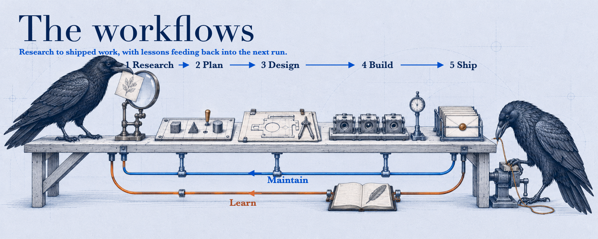

<!-- markdownlint-disable-file MD041 -->



# The workflows

My workflow has five main jobs: Research, Plan, Design, Build, and Ship. Maintain turns recurring problems into tests, rules, and documented lessons. Learn turns experience into linked notes and new research questions. Both feed back into the work.

Each section explains what I do, which tools I use, and when I'm ready to move on. The Rookery skills install separately. I use them alongside Compound Engineering, Impeccable, and Orca.

| Job | Goal | Key tools | Move on when |
|---|---|---|---|
| [Research](#research) | Gather enough information to plan | Deep research, `ce-ideate`, `storm-research`, `ce-pov` | The purpose is clear, findings are current and challenged, and useful information is gathered |
| [Plan](#plan) | State what to build and the limits it must respect | `ce-brainstorm`, `ce-plan`, `grilling` | The goal, completion checks, limits, inputs, tools, and final result are named |
| [Design](#design) | Write a design brief and shared design rules | `impeccable shape`, `impeccable audit` and `critique`, `DESIGN.md` | The brief exists and the visual choices are written down |
| [Build](#build) | Make and check one small part at a time | `ce-work`, `lfg`, Orca worktrees | Required CI checks pass, the work stays within its limits, and the design is followed |
| [Ship](#ship) | Review and verify the change, then merge it | `ce-simplify-code`, `ce-code-review`, `ce-commit-push-pr`, `ce-babysit-pr` | A human has read the work and its explanation makes sense |
| [Maintain](#maintain) | Keep the repo useful and prevent repeated mistakes | `repo-gardener`, `ce-compound`, `impeccable extract` | The lesson is saved in the strongest form that can enforce it |
| [Learn](#learn) | Connect new knowledge to existing notes and name the gaps | `atomic-note`, `personal-chief-of-staff`, `reviewing-meetings` | Notes are linked and unanswered questions are named |

Before starting work, I choose the available tools, who owns the result, and which models and effort fit the task. [Model and effort guidance](ROUTING.md) covers planning, execution, review, and design. The sections below explain where I start.

## Foundations

The workflows need three things:

- **A repository for the work.** I use repositories such as GitHub for code and knowledge. Branches let agents work in parallel, version control records changes, and backups help protect the work.
- **A lasting home for personal knowledge.** Obsidian, Notion, or plain Markdown files can hold knowledge outside an AI provider's memory. Point each agent at the same source so every tool can read it. Turning off an agent's built-in memory is a separate choice; it keeps knowledge from collecting somewhere only one provider can reach.
- **One shared set of agent instructions.** Every agent in every project on my machine reads the same file before the repository's own `AGENTS.md`. It contains habits that apply everywhere: try the simplest solution first, reproduce a bug before fixing it, and keep working until the result is verified. Each project adds its own rules. I change the shared file rarely and deliberately because it affects every run.

My shared instructions live at `~/.codex/AGENTS.md`. Claude Code imports them through a single `@~/.codex/AGENTS.md` line in `~/.claude/CLAUDE.md`, so Codex and Claude Code follow the same rules.

[GLOBAL-AGENTS.md](GLOBAL-AGENTS.md) is a published copy for reference. Agents in this repository do not load it. The local file remains the source of truth, and `scripts/sync-global-agents.sh` copies it here. A pre-push check catches a committed copy that has fallen behind. That check runs only in a clone configured with `git config rookery.globalAgentsSource`; contributors do not run it.

The skills work in VS Code, Claude Cowork, Cursor, Codex, Gemini CLI, and other compatible tools. I use [Orca](https://github.com/stablyai/orca) to run several agent tools side by side in one project.

## Research

**Goal:** Gather enough information to plan.

I start wide, looking at system design, current practices, industry trends, and how the pieces fit together. Then I narrow to the problem in front of me. I also ask the AI what I may have overlooked.

Once I understand the problem better, I look at what already exists. Lessons about a project live in its `docs/solutions/`. My personal knowledge vault holds notes and research that apply across projects. Each lesson has one home, so agents do not have to sort through duplicate copies.

I give the model the project background, the decision or work the research serves, current official documentation, and opposing views. Without that information, the answer can be generic or outdated.

The question determines which tool I use:

- Deep research. Ask a capable model directly to study a codebase, method, or topic. Use it when you need broad understanding without a specialized research process.
- `ce-ideate` from Compound Engineering. Develops ideas about what to build and checks them against evidence. Use it when research has not yet pointed to a clear product or improvement.
- [`last30days`](https://github.com/mvanhorn/last30days-skill). Finds recent discussion and reports of use about a topic or person. Use it when recent experience matters more than depth, such as when comparing the latest models.
- [`storm-research`](skills/storm-research/SKILL.md). Studies a hard question from independent practitioner, academic, skeptic, economist, and historian perspectives. It produces a source-backed briefing with the evidence, disagreements, and gaps. Use it when the research should become a lasting record of those different views.
- `ce-pov` from Compound Engineering. Gives a clear recommendation based on the project and checks outside facts when the answer depends on them. Use it for a focused decision that needs an answer rather than a research report to keep.

Before moving to Plan:

- **I know what the research is for.** The decision or work it supports is clear.
- **The findings have been checked.** They are current and hold up against official documentation and opposing views.
- **I have enough information to plan.** I can move forward without another round of research.

## Plan

**Goal:** Write what to build, how to check it, and the limits the work must respect.

I usually plan in the session that did the research. If the research needs to stay useful after the work ships, I maintain a findings document in `docs/research/` and plan from it. A one-time audit or early investigation stays with the issue, pull request, or research system. It does not become repository documentation by default.

First I settle the problem, what a good result looks like, and how I'll know it's solved. `ce-brainstorm` writes that down when the outcome is still open. `ce-plan` then records the decisions, parts of the work, files, tests, and risks. It leaves the implementation to the agent that builds it.

I read the first draft closely and spend more time on what we're building than on how the code will be written. A plan can sound reasonable and still produce something wrong or generic. I spend more time planning than I did before AI because changes are harder to make once execution is underway. AI also makes small experiments, research, and prototypes cheap enough to try ideas before and during planning.

Agents that were not in the planning session review the plan against the current system, recent research, and official documentation. An agent reviewing its own work shares the assumptions and blind spots that shaped it. That review can approve a convincing structure instead of checking the evidence.

[Compound Engineering](https://github.com/EveryInc/compound-engineering-plugin) drives this step. I choose the entry point based on what the research left unresolved:

- `ce-brainstorm`. Writes a plan of requirements and confirms what to build. Use it when important questions about the outcome remain open.
- `ce-plan`. Records decisions, parts of the work, files, tests, and risks in one plan. It does not implement the work. Use it when the outcome is clear enough to plan how to deliver it.
- `ce-debug`. Finds the cause of a bug before proposing a fix. Use it when the work starts with broken or unexpected behavior.
- `ce-pov`. Answers a focused planning question using the project's evidence. Use it when one decision blocks the plan and more research would add little.
- [`checking-simplicity`](skills/checking-simplicity/SKILL.md). Looks for ways to simplify a design, plan, or approach without losing what it needs to do. Use it when asked to simplify, during a build, or before adding lasting machinery that the current problem does not need.

Sometimes the remaining questions depend on one another. I consider a focused grilling session when a decision is costly to reverse, affects a large part of the system, determines later answers, or would otherwise leave the agent guessing how to judge completion. For example, who owns authentication may determine how long sessions last and who can access data. Settle that first. Unrelated open questions stay in `ce-brainstorm`; clear requirements and ordinary, reversible decisions go to `ce-plan`.

Install `grill-me` and `grilling` separately from [Matt Pocock's skills](https://github.com/mattpocock/skills). Each round asks the questions that can be answered independently, recommends an answer for each, and waits. Questions that depend on those answers come later. The tools look up facts in the repository or environment rather than asking you for them. The session settles decisions, and planning records them in the repository's documents.

Once I confirm that we understand the work the same way, it returns to the Compound Engineering planning session. For work an agent can finish on its own, I use this template:

```yaml
goal: Complete [objective] until [verifiable end state],
  respecting [constraints],
  using [inputs/tools],
  producing [artifact/handoff].
```

Before moving on:

- **The goal is clear.** We have named the work to finish.
- **Completion can be checked.** We agree on what proves it is done.
- **The limits are clear.** Scope, required approvals, excluded work, and quality expectations are stated.
- **The inputs and tools are known.** We know which sources, systems, and repositories the work needs.
- **The result is named.** The work will produce a merged PR, a findings document, or a decision someone can act on.

When a plan needs issues, [`managing-issues`](skills/managing-issues/SKILL.md) manages parent, sub-issue, and blocker relationships in GitHub or Linear. It reports which required open issues have no required sub-issues and are ready to start. Build still decides the models, worktrees, stacked branches, and order of work.

### Do I save plans?

No. Plans, brainstorms, and early ideas can stay in the ignored paths named in `.gitignore` while the worktree exists. Keep their useful results in the place that will maintain them. [Working artifacts](AGENTS.md#working-artifacts) defines where temporary material and lasting results belong.

## Design

**Goal:** Write a design brief and shared design rules that agents can follow.

Design helps refine the research and plan. It continues while building, polishing, and maintaining the interface. Work without an interface skips this step.

AI often falls back on the same gradients, feature cards, and groups of three. I counter that with a written design system: a chosen style, reusable design values with rules for their use, and the components that use them. I follow the [DESIGN.md standard](https://github.com/google-labs-code/design.md).

When design needs to come first, I start with [Impeccable](https://github.com/pbakaus/impeccable). It chooses the right design workflow unless the exact command is already clear.

- `impeccable shape`. Writes a design brief from the audience, desired feel, and visual limits. Use it before planning or building an interface whose visual direction is still open.
- `impeccable audit` and `impeccable critique`. Audit checks technical quality; critique reviews the visual design. Use them during design and after implementation to find concrete problems.
- The design system. Records design values, components, reasons, and rules in `DESIGN.md`. It gives agents shared visual guidance as the interface changes.

Before moving to Build:

- **The interface has a design brief.** For work with a substantial interface, design discovery has shaped the research and plan.
- **The visual choices are written down.** The design system names the reusable values and what agents must avoid.

## Build

**Goal:** Build and verify one small part of the plan at a time.

Several worktrees can run in parallel. A worktree is a separate working copy of the repository. Each agent builds on its own branch without overwriting another agent's work.

A harness is the tool running the agent, such as Claude Code, Codex, Hermes, or Grok. In Orca, each worktree can use the one that suits its task.

I choose models based on how I'll judge the result. For work I can check objectively, I compare the expected cost of getting a passing result, not just the price of one attempt. For look and feel, I use the cheapest model whose result stays close enough to the best. Work that needs both must pass the objective checks first; preference then decides among the passing results.

`ce-work` from Compound Engineering handles one part of the plan at a time so I can inspect changes as they land. `lfg` runs from plan to pull request without check-ins. `/goal` in Claude Code and Codex keeps working toward one completion condition across turns. I use these autonomous modes only when the goal is clear and completion can be checked.

Compound Engineering handles planning, execution, review, and saving lessons inside each worktree. One session usually owns the work. I add Executors when parts can be worked on separately and use orchestration tools to supervise them. A handoff lets another session take over. [Model and effort guidance](ROUTING.md) helps me choose models and an independent Reviewer where practical.

Tests, linters, CI checks, and the design system help enforce quality before a change ships. Written instructions still depend on being read and followed. Maintain explains where to put each kind of rule.

[Testing with agents](TESTING.md) covers repositories with several languages and projects, as well as smaller ones. It explains which checks belong in local work, at merge, and at release. The project owns check selection and caching across agent tools.

During a build, I use:

- [Orca](https://github.com/stablyai/orca). Runs parallel worktrees, delegates across agent tools, and supports feedback on selected elements in the browser. Use it for independent parts of a plan or direct visual iteration on an interface.
- **Impeccable, mid-build.** Reviews and polishes visual work, checks technical quality, handles edge cases, and offers three versions of a selected element with the option to apply one. Use it to keep the interface aligned with the design brief and the project's limits.
- `ce-test-browser` and `ce-dogfood`. Check the browser flows affected by a branch. Dogfood can also fix small problems, add regression tests, and commit its changes. Use `ce-test-browser` for a focused check or `ce-dogfood` for a repair pass that runs on its own.
- [`checking-simplicity`](skills/checking-simplicity/SKILL.md). Challenges a design decision or reassesses an existing system. Use it before adding lasting machinery that the current problem does not need, even when nobody has asked to simplify.

Before moving to Ship:

- **The required checks pass.** Run the selected CI and local checks, including browser checks for interface changes when the project requires them. Tests exercise the code that will ship, not a stand-in.
- **The work stayed within its limits.** Each agent built its assigned part. Changes in scope went back through Plan.
- **The design was followed.** Interface work matches the design system and brief.

## Ship

**Goal:** Review and verify the change, then merge it.

Build ends when the agents believe the plan is complete. I check that belief and refine the work before shipping. Simplifying and reviewing before opening the PR lets reviewers focus on what changed.

The shipping steps run in this order:

1. `ce-simplify-code`. Makes the code easier to follow without changing its behavior.
2. `ce-code-review`. Reviews the change independently before a PR exists.
3. `ce-test-browser` or `ce-dogfood`. Checks browser behavior when the change affects the interface. Use a test run or let dogfood find, fix, and commit problems as it goes.
4. `ce-noslop` and [`humanize`](https://github.com/harshaneel/humanize) (`ai-check`) for prose people will read. `ce-noslop` removes AI writing habits while keeping the author's voice. `ai-check` flags writing that sounds like AI.
5. [`writing-for-agents`](https://github.com/mattpocock/skills/tree/main/skills/productivity/writing-for-agents) for documents written mainly for an AI agent.
6. `ce-commit-push-pr`. Commits, pushes, and opens the PR after the project's publishing requirements pass for the commit being sent.
7. `ce-babysit-pr`. Handles CI failures and review feedback until its chosen monitoring mode reaches its documented stopping point.

I can also ask the agent to explain the change or a concept it introduced. Compound Engineering handles publication and monitoring without a separate local readiness check. Interactive publication normally hands off to babysit. For an orchestrated ordinary `mode:pipeline` publication, the caller must start babysit explicitly. Publishing a stack can hand off stack-aware monitoring; the caller keeps that watcher rather than starting another.

A successful bounded pipeline run and an interactive report that the PR looks ready to merge describe only what they checked. Neither means the PR was merged. I merge ordinary PRs myself. For a confirmed managed stack, an explicit `posture:stack-land` grant lets babysit use the native stack route and confirm it landed. Repo Gardener never gets that grant. Afterward, I write the changelog and release notes from the merged PRs.

CI blocks merge until the project's selected requirements pass. [Testing with agents](TESTING.md#local-merge-and-release-responsibilities) explains how to divide broader checks between local work and release. GitHub can enforce a PR for every change, resolved review comments before merge, and no direct pushes to main, including by administrators. Each of those protections must be turned on.

Before merge:

- **A human has read the finished work.** The written requirements were met, tests and QA passed, and a plain-language before-and-after walkthrough held up. `ce-babysit-pr` handles the mechanics; I read the review comments.
- **The explanation makes sense.** The agent explains what the issue fixed, with before and after examples.

## Maintain

**Goal:** Keep the repository useful and prevent repeated mistakes.

Repositories and systems need care over time. Maintenance runs throughout the work, not only after merge.

[`reviewing-ai-sessions`](skills/reviewing-ai-sessions/SKILL.md) reviews recent AI
sessions for recurring friction and guidance that has stopped earning its cost.
It proposes deletion, updates, or new guidance, placing each change where it can
hold. Run it for a weekly review or a shorter interval after a difficult run;
approve specific proposals before applying them through the appropriate workflow.

[`repo-gardener`](skills/repo-gardener/SKILL.md) checks one repository, sends Executors to ship one reviewable PR each through the installed Compound Engineering shipping skills, and posts one morning report. Run it on a schedule by name. A human still merges.

Impeccable handles design maintenance. `impeccable extract` finds patterns used three or more times for the same purpose and turns them into shared design values and reusable building blocks. `impeccable document` rebuilds the design documentation from what shipped, so the tools can read the design rules rather than guess.

`ce-compound` saves lessons worth keeping when I solve a problem, often before opening the PR. It writes the symptoms, cause, failed attempts, fix, and prevention strategy to `docs/solutions/`. Planning and debugging use those documents later, so I spend less time solving the same problem again.

Choose where to keep a lesson based on how it can prevent the mistake. A test runs without anyone remembering to read it. A written instruction only helps when someone reads and follows it. Use the strongest option that fits:

| Form | Where it lives | What makes it useful |
|---|---|---|
| Automatic check | Regression test, lint rule, git hook, CI check, performance budget, monitor | Runs on every change and catches the mistake without relying on memory |
| Rule for part of the codebase | An instruction tied to a path | Loads when work touches that path; the model still has to follow it |
| Reusable procedure | A skill for a recurring task | Can be invoked when the task comes up |
| Decision record | An architecture decision record with the choice, alternatives, and reasons | Keeps the explanation available to anyone who knows to look |
| Written instruction | A README line, code comment, or instructions file | Depends entirely on being read and followed |

When a lesson belongs in a skill, [`creating-portable-skills`](skills/creating-portable-skills/SKILL.md) creates, revises, migrates, or audits the package and checks its structure and installation. It sends evaluation to `build-eval` and tuning to `ce-retune`. Use it when a recurring gap needs a portable skill rather than a one-time instruction. [`SKILLS.md`](SKILLS.md) defines this repository's evaluation and evidence rules.

A bug I can reproduce becomes a regression test. A convention becomes a lint rule. Lessons that fit none of the stronger options become written instructions. That is often the right choice for something we cannot automate yet.

This matters with agents because they produce code quickly and do not reliably remember corrections between sessions. Lessons that depend on memory fade. A capable model planning in a repository can find the decision records and solutions without extra machinery for retrieving them.

Before moving to Learn:

- **The lesson is in the repository.** It has been saved in the strongest form that can enforce it.

## Learn

**Goal:** Connect what I learned to existing notes and name what I don't understand yet.

Learn is about my knowledge rather than the system's. Some lessons come from a software change. Others come from reviews, meetings, relationships, and the rest of life and work.

I choose the tool based on what I need to do:

- [`personal-chief-of-staff`](skills/personal-chief-of-staff/SKILL.md). Uses configured sources for a daily, weekly, or quarterly review. Run it to reflect, understand where things stand, and decide what to do next across life and work.
- [`reviewing-meetings`](skills/reviewing-meetings/SKILL.md). Turns completed meetings into draft notes and follow-up actions based on the meeting source. Run it after a meeting or when catching up. Each follow-up waits for approval before anything is written.
- [`managing-personal-crm`](skills/managing-personal-crm/SKILL.md). Keeps relationship information in one note per person. Messages and other raw interactions stay in their original apps. Use it to prepare for a conversation, record an interaction, reconnect with someone overdue, or find who could help with current work.

I usually capture lessons from software work before opening the PR. The approval menu can show an interactive overview of the change with a quiz. If that reveals a topic worth keeping, I use the [`atomic-note`](https://github.com/jrgilbertson/networked-thinking-skills) skill from Networked Thinking to write a note and link it to related topics. Questions the note leaves open become further reading, follow-up issues, or a new research question.

[Networked Thinking](https://networkedthinking.ai) is the system behind those notes. Each atomic note holds one idea and connects to related notes rather than being filed into folders. I wrote the book and the site, and the notes in this loop follow that method.

AI helps me move faster, but what I know determines how well I can use it. Broad knowledge lets me think beyond the code, propose an approach the model did not suggest, and connect the work to basic principles. It helps me question the result, tell good work from work that only looks good, and notice more of what I don't know.

For the loop to close:

- **The new knowledge is connected.** Useful topics became atomic notes linked to what I already knew.
- **The gaps are named.** What I still don't understand became reading, follow-up issues, or the question that starts the next Research pass.
